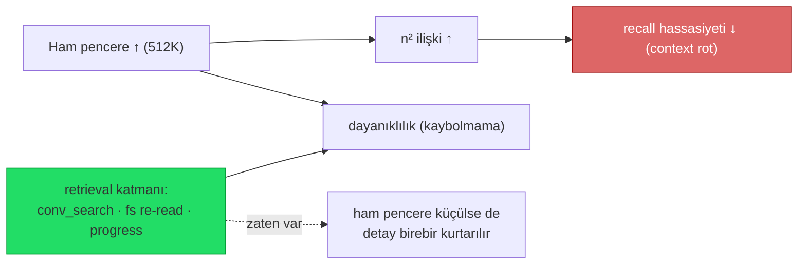

# 17 — Araç Çıktısı Token Optimizasyonu

> **Not (2026-11-17): TionHarness'in kendi kabuğu kaldırıldı.** Ajanlar komutu her zaman
> CLI'nin native kabuğuyla koşturur; in-process rtk komut filtresi, in-process sqz çıktı
> filtresi, `shellOutputCompression`/`shellCommandRewrite` ayarları, `no_compress` argümanı ve
> `TurnStep.optimizer` çipi gitti. rtk (`rtk hook claude`) ve sqz (`sqz hook claude`) yalnız
> claude-cli'nin native `Bash`'inde PreToolUse hook'u olarak çalışır; codex-cli/opencode-cli'de
> çalışmaz. Bkz. "rtk / sqz bugün" bölümü.

> **Not (2026-10-18):** Varsayılanlar değişti: `maxContextTokens` tabanı 800000→64000, gpt/codex bütçe payı 0.35→0.6, `autoCompactMode` rolling→auto, `maxToolOutputKB` 100→50; stall yargıcı kaldırıldı.

> Ajan araç çıktılarının (shell, dosya, MCP) LLM context'ine girmeden önce küçültülmesi.
>
> **Not (2026-09-10):** claude-cli `--tools` allowlist'i artık `TodoWrite`'ı daima
> ve (varsayılan açık `ClaudeCLINativeSubagents` ile) `Agent`'ı taşıyor; `Agent`'ın
> general-purpose/claude tipleri `Agent(<tip>)` scoped deny ile kapalı, Explore/Plan
> süreç içinde koşup transkripti ana çağrıya katlanıyor (yeni `claude -p` tabanı
> ödenmez). Native `TodoWrite` ve codex `update_plan` progress dosyasına aynalanıyor.
> (2026-11-17: ajan-düzeyi `NativeShell` alanı kaldırıldı; Bash ailesi artık her zaman
> açıktır, yalnız araç filtresi `Bash`'i kabul etmeyen ajanda bastırılır.) Ayrıntı
> `05-ILERLEME.md` "CLI yerleşik araçları: izleyerek serbest bırakma".
>
> **Not (2026-09-07):** token kalibrasyonu — claude-cli harness ek yükü artık gerçek
> turlardan (CLI sürümü, araç kataloğu hash'i) başına **öğreniliyor**; sistem promptu +
> araç şemaları anthropic `count_tokens` ile **bir kez** kesin sayılıp hash'le
> cache'leniyor; fold kapısı `cli-harness` kovasını bütçeliyor. Bkz. "Token
> kalibrasyonu (2026-09-07)".
>
> **Not (2026-09-04):** tur-içi araç-çıktısı budaması artık **taşmayı beklemiyor** —
> istek model penceresinin %55'ini geçince tur başına bir kez, bedava (LLM'siz)
> çalışıyor; eşik pencereye göre ölçekleniyor ve tur-içi tahmin artık araç şemalarını
> da sayıyor. Bkz. "Taşma-öncesi araç çıktısı budaması (2026-09-04)".
>
> **Not (2026-07-10): built-in araç-çıktısı sıkıştırması TAMAMEN KALDIRILDI.**
> TionHarness artık hiçbir built-in (deterministik veya LLM tabanlı) araç-çıktısı
> sıkıştırması **içermez**. Eskiden var olan iki sistem — "Sistem A" (deterministik,
> kural tabanlı, `internal/tools/compact`) ve daha eski "Sistem B" (ucuz-model LLM
> özeti) — ilgili ayarlar (`compactToolOutput` / `compactMaxLines` / `compactMaxBytes`),
> tasarruf sayaçları (`CompactSavedBytes` / `compactSavedBytes`) ve tüm bütçe/UI
> hücreleriyle birlikte **çıkarıldı**. Bu iş artık tamamen **harici araçlara** devredildi:
>
> - **`rtk`** — komut-katmanında: PreToolUse hook'u `rtk hook claude` claude-cli'nin
>   native `Bash` komutunu çalıştırmadan önce `rtk` üzerinden yeniden yazar. Ajan komutu
>   elle sarmalamaz. (2026-07-28 → 2026-11-17 arası bu iş in-process `rtkCommandFilter` ile
>   yapılıyordu.)
> - **`sqz`** — çıktı katmanında: PreToolUse hook'u `sqz hook claude` komutu çıktısı sqz'den
>   geçecek şekilde yeniden yazar. (2026-07-25 → 2026-11-17 arası in-process
>   `sqzShellFilter`.)
>
> Server-tarafı `clear_tool_uses` / API-native compaction (eskiyen/taşan sonuçlar) ve
> retrieval katmanı zaten transcript-düzeyi baskıyı karşılıyordu; ham araç-çıktısı
> kırpmasını harici bir hook/CLI katmanına taşımak built-in bir alt sistemi bakmaktan
> daha temiz. Aşağıda **harici araç tespiti + hook entegrasyonu** (artık ana yol)
> anlatılır; ardından prompt-cache ve bütçe konuları gelir.

## Neden harici?

Her araç çağrısının çıktısı konuşmaya eklenir ve sonraki model çağrısında **girdi token'ı**
olarak ücretlenir. `Bash` gibi araçlar büyük ham çıktı döndürebilir; `git status`, test runner,
`ls -R`, `grep` gibi komutlar context'i hızla şişirir. Bu baskıyı azaltmak **built-in bir katman
değil**, harici araçların (`rtk` / `sqz`, CLI hook'u olarak) sorumluluğundadır — mevcut
`internal/conversation` compaction'ı (transcript bütçesi) ve prompt-cache bu harici katmanı
tamamlar.

Built-in tarafında geriye kalan tek koruma tool'ların kendi 64 KB hard-cap'idir; hata/boş sonuçlar
her zaman olduğu gibi **hiç dokunulmadan** modele gider.

## CLI sağlayıcılarında trace çıktı cap'i (2026-08-27)

**Sorun:** `claude-cli` ve `codex-cli` araç döngüsünü kendileri koşturur; shell çağrısı
TionHarness'in araç katmanından geçmez (2026-11-17'den beri TionHarness'in kendi kabuğu da
yok), dolayısıyla oradaki çıktı cap'i uygulanmaz. CLI ne bastıysa `TraceStep.Output`'a birebir yazılır ve transkripte
kalıcı olarak kaydedilir. Gerçek vaka (WS24/SES576): store'un `.jsonl` dosyaları üzerinde
koşan tek bir `rg -n` çağrısı **20 satırda 1 MB** döndürdü (her satır tam bir mesaj JSON'u) ve
tek asistan mesajını 1,88 MB'a çıkardı.

**Çözüm:** `internal/providers/traceoutput.go` → `CapToolOutput`. İki bağımsız limit:

- `traceOutputMaxLineBytes` = 4 KB — "az satır, her biri devasa" vakası (satır başına tam kayıt).
- `traceOutputMaxBytes` = 64 KB — "çok sayıda normal satır" vakası.

Kesme her zaman **görünürdür** (`…[line truncated at 4KB]`, `[output truncated at 64KB]`) ve
UTF-8 rune sınırını bölmez. Bağlandığı noktalar: `codexcli_events.go` → `setStep` (her adım tek
bir noktadan geçer), `claudecli_stream.go` → `tool_result` atama.

## rtk / sqz bugün: CLI'nin native `Bash`'inde hook (2026-11-17)

**Durum:** TionHarness'in kendi kabuğu (köprülü `Bash`/`PowerShell`, arka plan kabuğu,
`monitor`) 2026-11-17'de kaldırıldı; ajanlar komutu her zaman CLI'nin **native** kabuğuyla
koşturur (claude-cli `Bash` ailesi, codex-cli'nin kabuğu, opencode-cli `bash`). Bununla
birlikte iki in-process katman da gitti:

- **in-process sqz çıktı filtresi** (`Runtime.sqzShellFilter`, `shell_optimizer.go`,
  `shellOutputCompression` ayarı, `no_compress` argümanı);
- **in-process rtk komut filtresi** (`Runtime.rtkCommandFilter`, `rtk_optimizer.go`,
  ölçülmüş beyaz liste `rtkRewriteWorthIt`, `Degraded` notu, `shellCommandRewrite` ayarı);
- bunları kartta gösteren `TurnStep.optimizer` / `OptimizerChip` ve claude-cli yolunun
  `optimizerLog`'u.

İkisi de artık **yalnız CLI hook'u** olarak çalışır. Workspace'in PreToolUse/PostToolUse
hook'ları her claude-cli turunda `--settings` dosyasına yazılır (`internal/climcp/settings.go`,
matcher çevirisi `internal/climcp/matcher.go`) ve CLI kendi `Bash`'inde ateşler:

| Araç | Bağlantı (Ayarlar ▸ Dış Araçlar, tek tık) | Ne yapar |
|---|---|---|
| `rtk` | PreToolUse, matcher `Bash`, komut `rtk hook claude` (`internal/exttools/catalog.go`) | rtk'nın kendi Claude Code hook işleyicisi: komutu kendi rewrite kayıt defterine göre `rtk <komut>`'a çevirir ya da dokunmaz |
| `sqz` | PreToolUse, matcher `Bash,PowerShell` (Claude Code'un Windows'taki native PowerShell aracı da kapsansın diye), komut `sqz hook claude` | komutu çıktısı sqz'den geçecek şekilde yeniden yazar (kayıpsız kısaltma sözlüğü / `§ref:…§` dedup işaretçisi) |

`rtk hook claude` düz bir komut kelimesidir, yani claude-cli'nin hook'ları çalıştırdığı bash
altında da geçerlidir (2026-07-31'de shell'i kilitleyen PowerShell tek-satırlık şablonun
tersine — aşağıdaki tarihçeye bak).

**Kapsam:** codex-cli ve opencode-cli workspace hook'larını taşımaz → bu ajanlarda rtk/sqz
**çalışmaz**. Ajan bilgilendirmesi `tokenOptimizerCapability`
(`internal/agent/capabilities_tokenopt.go`) ile sürer: hook komutunda `\brtk\b`/`\bsqz\b`
görülürse statik prefix'e "# Token optimization active" bloğu girer (rtk = kayıplı ÖZET,
geçen testler düşer; sqz = KAYIPSIZ, iki biçim; ikisi birlikte = istiflenir, rtk'nın küçülttüğü
sonuç sqz eşiğinin altında kalır). Ham çıktı kaçışı artık `no_compress` değil:
**`rtk proxy <komut>`** (rtk'yı atlar) ve sqz için **`sqz expand '§ref:<hash>§'`**.

### Bilinen boşluklar (in-process katmanın sağladığı ve artık olmayanlar)

- **Beyaz liste yok.** In-process filtre `rtk rewrite`'a yalnız ölçülmüş aileleri
  (`go`/`cargo`/`npm`/`pytest`/… + `git status`/`git log`) veriyordu. `rtk hook claude` ise
  rtk'nın kendi kayıt defterini uygular; ölçümde **yanlış ya da başka** sonuç üreten aileler
  (`npx`/`lint`/`tsc` — rtk lint "2 errors" derken gerçekte 90 hata; `uv pip list` → sistem
  python'u) artık rewrite edilebilir. Upstream karşılıkları: rtk
  [#950](https://github.com/rtk-ai/rtk/issues/950) (Windows'ta `.cmd` sarmalayıcıları:
  npm/npx/pnpm/tsc/corepack), [#1205](https://github.com/rtk-ai/rtk/issues/1205),
  [#294](https://github.com/rtk-ai/rtk/issues/294). Gerekirse kullanıcı rtk'nın kendi
  `[hooks] exclude_commands` ayarıyla (`%APPDATA%\rtk\config.toml`) bu aileleri muaf tutar —
  bu makineye özeldir ve TionHarness tarafından testle kilitlenemez.
- **`Degraded` uyarısı yok.** rtk gerçek hatayı yutabiliyor (ölçülen vaka: BOM'lu `go.mod` →
  rtk 0.44.1'de **tamamen boş** çıktı, exit 1). Eskiden yeniden yazılmış komut başarısız
  olunca çıktıya `[optimizer note: …]` ekleniyordu; şimdi yalnız prompt bloğu "özet hatayı
  açıklamıyorsa `rtk proxy <komut>` ile tekrar çalıştır" der.
- **Adım-başı tasarruf görünürlüğü yok.** sqz'nin stderr istatistiği (`[sqz] 57/841 tokens`)
  artık okunmaz; kazanç yalnız input-token düşüşünde ve `rtk gain`/`sqz gain` raporunda görünür.
- **2 KB eşiği** sqz'nin kendi davranışına kaldı (in-process `shellCompressMinBytes` gitti).

### Ölçümden kalan bilgi (rtk 0.44.1, 2026-07-28)

| Komut | Ham | sqz | rtk | rtk+sqz | Sonuç |
|---|---|---|---|---|---|
| `go test -v ./internal/tools` | 6107 | 3209 | **12** | 12 | rtk ezici |
| `git log -30` | 6595 | 2027 | 2157 | **1167** | istifleme |
| `git status` | 1090 | 876 | 811 | **549** | istifleme |
| `git diff _Docs` | 16184 | **7485** | 12556 | 10129 | sqz kazanıyor |
| `npm run build` (vite) | 934 | 885 | 923 | **404** | istifleme |
| `npx eslint src` | 18943 | 10483 | 49 | 64 | **sayı yanlış** (rtk lint) |
| `npx tsc --noEmit` | 4500 | **1832** | 4534 | 1700 | rtk kazanç yok |

Sonuç: rtk ve sqz karşı uçlarda çalışır ve istiflemek çoğu vakada en iyisidir (bu yüzden
eski `token-conflict` uyarı kartı 2026-07-28'de silindi). Dispatcher komutlar (`npx`, `lint`,
`uv`) rtk'da kırılır; doğrudan koşucular (`go`, `cargo`, `pytest`, `npm run`) sorunsuzdur.
`rtk rewrite` başarıda belgelenen 0 yerine **3** döner (rtk 3.x) — rtk'yı doğrudan çağıran bir
araç çıkış koduna değil çıktıya bakmalıdır.

### Araçların kendi ayarları (TionHarness dışı)

| Araç | Yapılandırma | İşe yarayan anahtarlar |
|---|---|---|
| rtk | `%APPDATA%\rtk\config.toml` (`rtk config --create` ile oluşur) | `[hooks] exclude_commands` — belirli komutları rtk'dan muaf tut · `[tee] enabled/mode` (varsayılan `failures`) · `[limits] grep_max_results`, `status_max_files`, `passthrough_max_chars` · `[filters] ignore_dirs/ignore_files` · `[telemetry] enabled=false` |
| sqz | `sqz init` ile kurulan preset'ler | `sqz reset --cache-only` (bayat `§ref:` token'ları) · `sqz expand` (ref → tam içerik) · `sqz tee list/get` · `sqz status`/`gain`/`stats` |

#### Bakım paneli — Ayarlar ▸ Harici Araçlar (2026-07-28)

Config anahtarları ayar olarak yansıtılmaz (makine geneli; TionHarness ayarları workspace
başına). Bunun yerine iki parametresiz **eylem** (`internal/api/external_tools_maint.go`):

| Eylem | Uç nokta | Ne yapar |
|---|---|---|
| Tasarruf raporu | `GET /api/external-tools/token-report` | `rtk gain` + `sqz gain` çıktısını **birebir** gösterir; TionHarness yeniden hesaplamaz |
| sqz dedup önbelleğini temizle | `POST /api/external-tools/sqz-reset-cache` | `sqz reset --cache-only` — bayat `§ref:…§` işaretçileri ajanı şaşırttığında |

### Tarihçe (2026-07-25 → 2026-11-17)

Kısa kronoloji; ayrıntı `05-ILERLEME.md` ve arşivlenmiş ilerleme kayıtlarında, kod
`git log -- internal/agent/rtk_optimizer.go internal/agent/shell_optimizer.go` ile:

1. **2026-07-25 — in-process sqz.** `sqz hook claude` yalnız native `Bash` adını tanıyordu;
   TionHarness tüm kabuğu köprülü `mcp__tionharness_interaction__Bash`/`…__PowerShell`
   üzerinden koşturduğu için hook hiç ateşlenmiyordu. Sıkıştırma sunucu tarafına
   (`ShellTool.WithOutputFilter`) taşındı.
2. **2026-07-28 — in-process rtk + çip.** Aynı sebeple rtk hiç çalışmıyordu (SES14/15: 81
   shell çağrısının 0'ı). Ölçülmüş beyaz listeli komut filtresi, `Degraded` koruması ve
   `OptimizerChip` eklendi.
3. **2026-07-31 — rtk hook şablonu kaldırıldı.** Ayarlar'daki "rtk'yı bağla" PowerShell
   tek-satırlık bir PreToolUse hook'u kuruyordu; claude-cli hook'ları bash ile çalıştırdığı için
   ilk `|`'da ölüp WS10/SES63'te **her Bash çağrısını** bloke etti. rtk o zaman ayara
   (`shellCommandRewrite`) taşındı. Ders: iki farklı hook runner varken hook gövdesi ikisinde
   de geçerli olmalı (`powershell -NoProfile -File <script.ps1>` ya da düz komut kelimesi).
4. **2026-11-17 — kendi kabuk kaldırıldı.** Köprülü kabuk gidince in-process filtrelerin
   varlık sebebi de gitti: CLI'nin native `Bash`'i hook'ları doğrudan ateşler. rtk düz komut
   `rtk hook claude` ile yeniden hook oldu.

## Kabuk ortamı ipucu — `/c/` vs `/mnt/c` (2026-07-28)

Windows'ta `Bash` aracını **git-bash mi WSL mi** karşıladığı OS'tan türetilemez ama
komuttaki yol yazımını tamamen belirler. Prompt bunu söylemediği için ajan her oturumda
sıfırdan keşfediyordu: SES14 ve SES15 traceleri **ilk üç shell çağrısını** `/mnt/c/...`
deneyip `No such file or directory` alarak harcadı, sonra `/c/...`'a geçti — her yeni
oturumda yeniden.

`shellEnvironmentCapability` (`internal/agent/capabilities_shellenv.go`) çözülen lehçeyi
(`tools.POSIXShellFlavor()` → `gitbash` / `wsl` / `unix`) statik prefix'te **bir kez**
bildirir: mount kökü (`/c/` vs `/mnt/c/`), Windows PATH/`.exe` davranışı, `127.0.0.1`
erişilebilirliği. Native Unix'te blok **basılmaz** (model zaten o düzeni varsayıyor →
boşuna token). Diğer capability'ler gibi hem chat (`composeTurnRequest`) hem headless
(`autonomousSystemPrompt`) yolundan geçer. Test: `TestShellEnvironmentGuidance`.

**2026-11-17:** blok yalnız **claude-cli** ajanlarına basılır (Claude Code'un `Bash`'i
ana makinenin POSIX kabuğunu — Windows'ta git-bash — kullanır); codex-cli ve opencode-cli
kendi kabuklarını getirir ve bu blok onları anlatmaz. Eski `ShellEnabled()` kapısı kalktı;
`POSIXShellFlavor` artık `internal/tools/posix_shell.go`'dadır.

## Harici araç tespiti (presence-only) — ana yol

Ayarlar → **Hooks** ekranındaki "Kurulu mu kontrol et" butonu (panel açılışında otomatik de çalışır), bu
cihazda isteğe bağlı harici CLI araçlarının **kurulu olup olmadığını** gösterir. Liste artık yalnız
token araçlarıyla sınırlı değil; **kategorilere** ayrılır:

| Kategori (`category`) | Araç | Kullanım (`wire`) |
|---|---|---|
| `token` (Token / bağlam optimizasyonu) | `rtk`, `sqz` | `hook` — tek tıkla PreToolUse hook'u bağlanır (`rtk hook claude` / `sqz hook claude`); yalnız claude-cli'nin native `Bash`'inde ateşlenir |
| `render` (Render / diyagram) | `mmdc` (mermaid-cli) | `cli` — yerelde mermaid→SVG/PNG dosya çıktısı |

- Backend: `GET /api/external-tools` (`api/external_tools.go`) → `exec.LookPath` ile PATH'te arar.
  **Araçları kurmaz, çalıştırmaz, değiştirmez** (Windows'ta PATHEXT'e saygılı). Dönüş:
  `[{name,desc,url,category,wire,found,path}]`. Yeni araç eklemek = `knownExternalTools`'a tek giriş
  (yalnız `wire="hook"` ise frontend `TOOL_HOOK_TEMPLATES`'e ek şablon gerekir).
- Frontend: `systemApi.externalTools()` + `HooksPanel`; araçlar `category`'ye göre gruplanır, `wire`'a
  göre rozet/buton gösterilir (`hook`→Bağla/Aktif toggle, `mcp`→MCP rozeti, `cli`→CLI rozeti) + repo linki.
- Bu yalnızca **bilgilendirme + opsiyonel wire-up**'tır; TionHarness bu araçları kendiliğinden çalıştırmaz.
  Araç-çıktısı sıkıştırması **artık yalnız bu harici yoldadır** (built-in `compact` alt sistemi
  2026-07-10'da, in-process rtk/sqz filtreleri 2026-11-17'de kaldırıldı): `rtk` ve `sqz` CLI
  hook'u olarak bağlanır. `cli` araçları (`mmdc`) ajan tarafından CLI'nin kabuğuyla kullanılır.

### `rtk` / `sqz` hook entegrasyonu

- İkisi de `token` kategorisinde, `wire="hook"` olarak listelenir → Ayarlar ▸ Dış Araçlar'da
  tek tıkla **PreToolUse** hook'u olarak bağlanır (frontend `TOOL_HOOK_TEMPLATES`): rtk
  `Bash` + `rtk hook claude`, sqz `Bash,PowerShell` + `sqz hook claude`. Komutlar düz komut
  kelimesidir (pipe/PowerShell sözdizimi yok) çünkü claude-cli hook'ları bash ile çalıştırır.
- TionHarness kazanımı **ölçmez** (Claude Code hook sözleşmesi tasarruf sayacı sunmaz) —
  kazanç dolaylı olarak input-token düşüşünde ve `rtk gain`/`sqz gain` raporunda görünür.
- Ajan komutu elle `rtk` ile sarmalamaz; hook bunu yapar (prompt bloğu da bunu söyler).

## Sınırlar / Notlar

- Built-in araç-çıktısı **sıkıştırması** yoktur; tek built-in müdahale, boyut için bir
  **backstop kırpması**dır (`internal/tools/registry.go`): eşik `maxToolOutputBytes`
  (varsayılan **50 KB** — 2026-10-18'de 100 KB'tan düşürüldü; ayar `maxToolOutputKB`, `applySettings` → `SetMaxToolOutputBytes` ile
  process-global itilir). Eşiğin altındaki çıktı **hiç dokunulmadan** geçer, yani kullanıcı
  modele giden `ToolResult` ile UI'da gösterilen/persist edilen `TurnStep.Output`'u birebir
  aynı görür (harici hook uygulanmışsa her ikisi de hook'tan geçmiş haliyle gösterilir).
- Eşiği aşan çıktı **atılmaz, artifact'e taşınır** (2026-08-28, `capToolOutputOffload`):
  ctx'te bir artifact sink varsa (`tools.WithArtifacts` — her native turda oturuma bağlı
  olarak takılır) **tam çıktı** `text` türünde bir artifact olarak kalıcılaştırılır ve modele
  baş (`maxToolOutputBytes`'ın %70'i) + son (kalan bütçe) + artifact kimliği verilir. Elenen
  orta kısım `read_artifact` (`builtin_artifactmgmt.go`) ile geri okunabilir. Baş+son
  bölünmesinin nedeni: yalnız baş kırpması çıkışı (exit kodu, son satırlar, hata kuyruğu)
  kaybeder.
- Sink yoksa (oturumsuz tur, claude-cli köprü registry'si) veya artifact yazımı hata verirse
  davranış eskisiyle **bayt-bayt aynı** düz kırpmadır (`capToolOutput` → `…[truncated N bytes]`);
  depolama sorunu çıktıyı bozar ama tool çağrısını başarısız etmez. Test:
  `internal/tools/registry_cap_test.go`.
- Komut-özel akıllı kısaltma (git/test/grep'e özgü) built-in tarafta yok; bu iş harici `rtk`/`sqz`
  araçlarının komut-aile kurallarına bırakıldı.
- claude-cli delegasyon yolu kapsam dışıdır (çıktıları TionHarness'in `ToolResult` katmanından geçmez).

### Tool dizisi prompt-cache breakpoint'i (2026-07-02)

Anthropic prefix-cache sırası `tools → system → messages`. Eskiden cache breakpoint
yalnız static **system** bloğundaydı; tool şemaları dolaylı (system prefix'i sayesinde)
cache'leniyordu → system bloğu değişirse tool cache'i de düşerdi. Artık `toAnthropicTools`
caching açıkken **son tool'a bağımsız bir breakpoint** koyuyor (1s TTL, system'le aynı;
sıra `tools(1h)→system(1h)` geçerli). Böylece tool tanımları **kendi prefix'inde** cache'lenir
ve bir sistem-prompt düzenlemesi tool cache'ini bozmaz (Anthropic önerilen "son araca
breakpoint" pratiği). Politika değişmedi: yalnız `extendedCache` açıkken; kapalıyken hiçbir
tool breakpoint'i eklenmez. Kod: `internal/providers/anthropic.go` (`anthropicTool.CacheControl`,
`toAnthropicTools`). Test: `TestToAnthropicTools_*`.

### Konuşma geçmişi kayan breakpoint'i (2026-07-02)

Önceki iki breakpoint yalnız **statik** prefix'i (tools + system) cache'liyordu; her turda
**tüm transkript** için tam input ücreti ödeniyordu. Uzun oturumlarda (özellikle Fable 5'in
1M penceresinde) baskın maliyet kalemi ham geçmiştir. Artık `toAnthropicMessages` caching
açıkken **son mesajın son bloğuna** kayan bir breakpoint (1h TTL) koyuyor → tüm konuşma
prefix'i cache'lenir. Anthropic sırası `tools → system → messages`, breakpoint limiti 4;
`tools(1) + system-static(1) + history(1) = 3` güvenle içeride. Tur N'de prefix cache
**yazımı** olur, tur N+1'de aynı prefix cache **okuması** (0.10×) olur ve breakpoint en yeni
mesaja kayar (standart "sliding breakpoint"). Breakpoint son bloğa konur — rol/blok türü
farketmez (trailing `tool_result` da olur). Politika birleşik: yalnız `extendedCache` açıkken;
`req.MaxTokens==0` yolu etkilenmez. Kod: `contentBlock.CacheControl` + `toAnthropicMessages`
(iki çağrı yeri: `Complete`/`Stream`). Test: `TestToAnthropicMessages_*`.

> **Uyarı — thinking cache'i bozar:** adaptif thinking parametresi tur-arası değişirse
> mesaj prefix'i geçersiz olur (cache miss). `resolveThinkingBudget` deterministik olduğundan
> normalde sabit kalır; bir ajanın thinking seviyesini oturum ortasında değiştirmek yeni bir
> cache yazımı tetikler.

### Hedge breakpoint + blok-bazlı coalesce (2026-07-08)

Cache denetiminde bulunan iki kırılım senaryosunun kapatılması:

1. **Hedge breakpoint (4. breakpoint):** Anthropic cache araması bir breakpoint'ten
   yalnız **~20 content block** geriye bakar. Tek kayan breakpoint'le, büyük bir paralel
   tool batch'i (N `tool_use` + N `tool_result` bloğu > 20) önceki çağrının cached
   prefix'ini bu ufkun dışında bırakıp **tüm geçmişi** yeniden yazdırabiliyordu. Artık
   `toAnthropicMessages` kayan breakpoint'e ek olarak **bir önceki taşıyabilen mesajın son
   bloğuna** ikinci bir breakpoint (hedge) koyar — bu konum bir önceki çağrının breakpoint
   pozisyonudur (veya çok yakınıdır), yani eski prefix orada garantili bulunur ve yalnız
   yeni kuyruk yazılır. Raw (verbatim-echo) mesajlar marker taşıyamaz → yürüyüş en yeni
   Raw-olmayan öncüle düşer. Bütçe: `tools(1) + system(1) + hedge(1) + rolling(1) = 4`
   (API maksimumu, tam kullanım). Test: `TestToAnthropicMessages_RollingHistoryBreakpoint`,
   `_NoHedgeOnSingleMessage`, `_HedgeSkipsRaw`, `TestCacheBreakpointStability`.

2. **Blok-bazlı coalesce (anthropic yolu):** Çok-ajanlı oturumda art arda iki aynı-rol düz
   mesaj eskiden `coalescePlainSameRole` ile öncekinin `Text`'ine `"\n\n"` ekleyerek
   birleşiyordu — **cached prefix'in son mesajının baytları değişiyor**, o noktadan itibaren
   cache düşüyordu. Artık anthropic yolu birleştirmeyi `toAnthropicMessages` içinde
   **blok seviyesinde** yapar: sonraki tur, önceki mesaja **ayrı bir text bloğu** olarak
   eklenir; önceki blokların baytları aynen kalır, rol alternasyonu korunur. (Boş
   placeholder text bloğu yerinde doldurulur.) `coalescePlainSameRole` yalnız minimax chat
   yolunda kaldı (blok kavramı ve prefix cache'i yok). Test:
   `TestToAnthropicMessages_BlockWiseCoalesce`.

> **Bilinen kalanlar (bilinçli):** (a) tur-içi Raw echo ↔ tur-sonu persist bayt
> ıraksaması — her yeni turun ilk çağrısında yalnız son turun segmenti yeniden yazılır;
> (b) eski modellerdeki `foldSystemMessages` uyumluluk yolu hâlâ text-level katlar;
> (c) tüm breakpoint'ler tek `cacheTTL` (`1h`) — history için 5m adaptif TTL ayrı bir
> optimizasyon adayı (yazma primi 2.0× → 1.25×).

### Prompt Epoch — oturum-başı donmuş bağlam snapshot'ı (2026-07-08)

Yukarıdaki tur-içi düzeltmelerin tamamlayıcısı: **oturum-ortası** konfigürasyon
değişikliklerinin (skill kurulumu, ayar/talimat düzenlemesi, MCP araç listesi
değişimi, capability toggle, katılımcı değişimi) cache'i kırması, statik prefix'in
(tools + statik system) oturum başında **dondurulmasıyla** engellendi. Değişiklikler
diske anında iner ama prompt'a yalnız cache'in zaten öldüğü anlarda (compaction,
1h TTL soğuması, model/workdir/katılımcı değişimi, `/refresh-context`) adopte
edilir; bu arada ajan dinamik tarafta "snapshot eski" notu görür. Workspace ayarı
`PromptEpochEnabled` (default açık). Detay **[57-PROMPT-EPOCH.md](57-PROMPT-EPOCH.md)**.

## the external agent project'tan Aktarılan Fikirler

> Kaynak: `external-agent-oss` ([repo](https://github.com/external-agent-project/external-agent-oss)) bağlam-yönetimi
> incelemesi (2026-06-22). the external agent project çoğu bağlam işini Claude Agent SDK'ye devreder; TionHarness'in açık
> motoru genel olarak daha kontrollü. Aşağıda **sırada bekleyen** dokunuşlar (TODO) + **tamamlananların**
> tek-satır özeti (tam tarihçe → [05-ILERLEME.md](05-ILERLEME.md)).

### Sırada (TODO)

> **Not (2026-07-10):** Eski "komut-aile-bazlı deterministik bash sıkıştırıcı" ve
> "`_intent` açık niyet enjeksiyonu" TODO'ları **iptal edildi** — ikisi de kaldırılan
> built-in `compact`/özet alt sistemine dayanıyordu. Komut-aile-özel akıllı kısaltma
> ihtiyacı artık **harici araçlarla** (`rtk`/`sqz`) karşılanır; bu araçlar zaten
> `git diff`/`ls -R`/test-runner/`grep` gibi komutlar için komut-ailesine özel kurallar
> içerir. TionHarness tarafında yapılacak tek iş varsa o da `sqz` hook şablonlarını /
> `rtk` sarmalama kılavuzunu güncel tutmaktır.

### Tamamlanan iyileştirmeler (özet)

> Tam tarihçe (test adları, canlı-test bulguları, ara-revizeler) → [05-ILERLEME.md](05-ILERLEME.md).
> **Not (2026-07-10):** Aşağıdaki "Sistem A/B" (built-in araç-çıktısı sıkıştırması)
> kayıtları **tarihseldir**; ilgili alt sistem kaldırıldı. Konuşma-özeti (transcript
> compaction) ve prompt-cache iyileştirmeleri geçerliliğini korur.

- **✅ claude-cli `--tools` allowlist + araçsız yardımcı çağrılar + native yönlendirme** (2026-09-03) — ölçüm ve kaldıraçlar yukarıda "claude-cli prefix anatomisi" bölümünde; taban 36k → 11k (köprülü tur) / 7k (araçsız), yardımcı çağrılar anthropic API'de ~1–2k.
- **✅ Density-aware token tahmini** (CG-9/1, 2026-06-22) — `estimateText` yoğun içerikte ~1.5 chars/token, düz metinde ~3; `tokens_test.go`.
- **✅ Auto-compaction görünürlüğü** (2026-08-11) — rutin bütçe-tabanlı rolling-summary fold'u (`Prepare`) artık iki yüzeyde görünür: (1) `debug.jsonl`'e `type:"compaction"` olayı (`Name:"auto"`/`"manual"`, `SavedBytes`+`Detail`) her tur-türünde (chat/spawned/wake/koordinatör); (2) interaktif chat turunda başa **görünür lead-step** ("🗜 Bağlam otomatik sıkıştırıldı — N mesaj katlandı") — manuel `/compact` ile **aynı hub kanalı** (canlı SSE + çok-pencere `publishHub` + kalıcı trace). **Queue notu:** auto-fold zaten serialize turn'ün içinde (inbox slotunu tutar), bu yüzden manuel komut gibi `acquireInboxSlot`'a girmez — girse self-deadlock olurdu. `Prepared.FoldedMsgs` step'i besler. Detay `38`.
- **✅ charsPerToken kalibrasyonu 4→3** (2026-07-23) — yeni Claude tokenizer'ı (Sonnet 5 / Opus 4.7+) sabit metinde ~%35 daha çok token üretiyor; ~1.15M karakter gerçek oturum metni üzerinde ölçüm (o200k proxy) 3.29 chars/token (Türkçe 3.25) → eski `4` değeri token'ı ~%33 eksik sayıp geç compaction/bağlam taşması riski doğuruyordu. Yalnız bütçe/compaction tahmini ve UI ölçerini etkiler; **fatura gerçek `usage`'dan geldiği için değişmez.**
- **✅ Thinking-token atfı** (2026-07-23) — API `output_tokens`'ı thinking + görünürü ayırmıyor; `Usage.ThinkingTokens` agent katmanında `out − görünür(text+tool_use)` olarak türetilir (`budget.go deriveThinkingTokens`, native + `Calls<=1`), `llm_call.think` alanına yazılır, `GetDebugSummary/GetTurnDebug` → `thinkingShare` ile Debug kartı + mesaj panelinde "Düşünme %N" olarak görünür. Atıf amaçlı — `out`'un içinde zaten var, **faturaya eklenmez.** Ölçüm: thinking açık turlarda çıktının ~%40'ı gizli akıl yürütme. Detay `38`.
- **✅ Per-model context-window metadata** (2026-06-22) — `ModelInfo.ContextWindow` + `ContextWindowFor(provider,model)` aile-tablosu; UI + bütçe-tavanı guard için.
- **✅ Modele göre akıllı varsayılan bütçe** (2026-06-22) — `EffectiveBudget` model penceresine göre ölçekler; fraction/ceil canlı yapılandırılabilir. **Güncel değerler → [§12](#12--context-rot-farkındalığı-ve-bütçe-stratejisi-2026-06-25)** (256K + adaptif).
- **✅ Yapılandırılmış konuşma-özeti** (Claude Code parite, 2026-06-23) — `compactPrompt` 8-bölümlü yapı + anti-decay; `compactMaxOutputTokens=8192`; kapanış-cue'su claude-cli framing'ini bastırır. **Güncelleme (2026-08-28):** şablona (`internal/prompts/defaults/compact.md`) 9. bölüm **Standing Constraints** eklendi — konuşma boyunca söylenmiş ve oturumun kalanında yürürlükte kalan kural/yasak/çalışma sözleşmeleri **birebir (verbatim)** taşınır; parafraz/birleştirme yasak, hiç yoksa bölüm atlanır. Fold başına eriyen kısıtlar ("kullanıcı bunu yasaklamıştı" bilgisinin kaybı) en sık görülen compaction regresyonuydu.
- **✅ Post-compact kurtarma işaretçisi** (2026-06-23) — özet bloğu `conversationSummaryBlock` ile sarılır ("tahmin etme; `conversation_search` veya fs ile yeniden oku").
- **✅ `conversation_search` güçlendirme** (2026-06-24) — `full=true` (birebir tam metin) + `context=N` (çevre turlar) + `session_id`; bkz. [27-CROSS-SESSION-SEARCH.md](27-CROSS-SESSION-SEARCH.md).
- **✅ claude-cli oturum sürekliliği `--resume`** (2026-06-24, opt-in) — `ClaudeResume` ile sıcak prompt-cache; warm modda compaction CLI'a geçer (deneysel). Akış: `api/chat_resume.go`.

## Bütçe görünürlüğü — Tasarruf Merkezi + session bazlı

> **Güncelleme (2026-07-10):** Built-in araç-çıktısı sıkıştırması kaldırıldığı için
> tasarruf ölçerleri (`CompactSavedBytes` / `compactSavedBytes` **ve** LLM varyantı
> `CompactSavedBytesLLM` / `compactSavedBytesLLM`) ile ilgili API alanları, DB metotları
> (`AddCompactionSavings`, `AddLLMCompactionSavings`, `AddSessionCompactionSavings`,
> `AddSessionLLMCompactionSavings`) ve UI hücreleri **çıkarıldı**. Bütçe ekranında:
> - **Tasarruf Merkezi** artık **tek hücre** gösterir: **Prompt-cache USD** (gerçek
>   faturalandırma etkisi olan tek kaynak). "Sıkıştırma · kural" hücresi ve
>   "Toplam context tasarrufu" footer'ı kaldırıldı.
> - **Trend metrik seçici** artık **3 seri**dir: **Token · Maliyet · Cache tasarrufu**
>   (`TREND_METRICS`). "Sıkıştırma" serisi kaldırıldı.
> - Session/agent kartlarındaki "Sıkıştırma (kural)" satırı ve ilgili boş-durum koşulu
>   kaldırıldı; yalnız Prompt-cache kazancı kalır.

Cache tasarrufu ile session bazlı kullanım/maliyet dağınık/gizli değildir; kullanım hem
**ajan+gün** hem **session (ömür-boyu)** anahtarlı tutulur. Kalıcı olan iki mekanizma:

### Prompt-cache görünürlüğü
- API: `GET /api/usage` totals + cumulative + trend `savingsUSD` (prompt-cache USD tasarrufu) taşır.
- UI: Bütçe ekranında **Tasarruf Merkezi** bölümü tek hücre — **Prompt-cache** (gerçek USD).
  Bayt/token tahmin hücreleri artık yoktur.

### Soğuma israfı rollup'ı (2026-08-03)
Tasarrufun tersi: geç gelen bir tur sıcak prompt-cache öneğini soğuttuğunda (TTL/eviction),
önek okuma yerine **yazma** tarifesinden yeniden ödenir; bu **önlenebilir** primin izole USD'si.
- **Kaynak:** cache-break tespiti (`agent/cachebreak.go`) yalnız `ttl-or-server-eviction` durumunda
  `providers.CoolingWaste` ile hesaplar (native Anthropic `cache_creation` token'ı; abonelikte tahmini,
  OpenRouter'da ~0) → hem debug olayına (`wasteUsd`) hem de günlük usage kaydına yazar
  (`db.AddCoolingWaste` → `Usage.CoolingWasteUSD`/`CoolingWasteEstimated`). **Token maliyetiyle çift-sayım
  yok** — o write token'ları zaten `ByModel`'de fiyatlı; bu yalnız kaçınılabilir kısmı ayırır.
- **API:** `GET /api/usage` totals + cumulative `coolingWasteUSD`/`coolingWasteEstimated`, trend
  `coolingWasteUsd`, per-agent satırda `coolingWasteUsd`.
- **UI:** Bütçe ekranında cumulative kart **"Soğuma israfı (son Ng)"** + Tasarruf Merkezi'nde negatif tonlu
  **"Soğuma israfı (önlenebilir)"** hücresi (ikisi de yalnız > 0 iken; abonelikte `~`). Detay `38-SESSION-DEBUG.md`.
- Test: `providers.TestCoolingWaste` · `db.TestAddCoolingWaste` · `db.TestDebugSummaryCoolingWaste`.

### Session bazlı kullanım/maliyet
- DB: `SessionUsage` rollup (`internal/db/store_session_usage.go`) — **sessionID anahtarlı, ömür-boyu**
  (gün-reset YOK); ByKind/ByModel + cache sayaçları. Dosya `store/session-usage/<sid>.json`.
  Metotlar: `AddSessionUsageKind` · `GetSessionUsage`. Boş sessionID = no-op.
- Wiring: `RecordUsage` ctx'teki `SessionIDFrom`'u okuyup ajan kaydının **yanında** session
  rollup'a da yazar (chat/schedule/spawn/flow yolları zaten `WithSessionID` damgalı).
- API: `GET /api/sessions/{id}/usage-detail` (cost helper'ları `modelRowsFor` ile paylaşılır → workspace ekranıyla
  birebir tutarlı). UI: `SessionDetailPanel`'de **"Bu oturumun harcaması"** kartı (maliyet + prompt-cache
  kazancı) — eskiden yalnız "ajanın bugünkü toplamı" gösteriliyordu.

### Hata turu faturalandırması (2026-08-31)

Sağlayıcı sözleşmesi hata durumunda `(nil, err)` döner; bu yüzden **başarısız tur
sıfır token** olarak kaydediliyordu. Oysa istek gönderildikten *sonra* düşen bir
tur (sonuç zarfında rate-limit/auth reddi, son iç tur sırasında CLI çökmesi)
girdi tokenlarını ve tamamlanmış her iç gidiş-dönüşü zaten ödemiştir — yani en
pahalı turlar tam olarak $0 faturalanıyordu.

**Sözleşme** (`internal/providers/usage_error.go`):

- `UsageError{Err, Model, Usage, ProviderCalls}` — hâlâ bir `error`'dır
  (`Error()`/`Unwrap()`), yanına *ayrıca* bir `*Response` konmaz. Bilinçli:
  `Complete`/`Turn` çağıranlarının tamamı "hata varsa yanıt yoktur" varsayar;
  hatanın yanına dolu bir yanıt koymak, `err` kontrolünü atlayan bir çağrı
  noktasında başarısız turu başarılı gösterirdi.
- `WithUsage(err, model, usage, providerCalls)` — hatayı usage ile sarar.
  `err == nil` **veya** usage tamamen sıfırsa hatayı **değiştirmeden** döndürür;
  zincirde zaten bir `UsageError` varsa yeniden sarmaz (en içteki sarmalama,
  ölçümü yapan ayrıştırıcıya en yakın olandır).
- `UsageFromError(err)` — `errors.As` ile taşınan usage'ı çıkarır.

**Kayıt yolu** (`internal/agent/toolloop.go`, `recordFailedUsage`): hata usage
taşımıyorsa **hiçbir şey kaydedilmez** (hiç istek gitmemiş demektir).
Taşıyorsa `ue.Model` (boşsa `req.Model`) ile normal `RecordUsage` çağrılır — yani
başarısız tur da ajan+gün ve session rollup'larına, `ByKind`/`ByModel` dahil,
başarılı tur ile aynı yoldan işlenir.

Çağrıldığı üç yer, ikiye ayrılır:

| Yol | Fonksiyon | Kapsam |
|-----|-----------|--------|
| Tool-loop içi | `recordedComplete` | Kalıcı (persistent) CLI turu düştüğünde **ve** ardından tek-atımlık `Complete` düştüğünde ayrı ayrı — fallback zaten ayrı faturalanır, atlanırsa bütün bir turun tokenları düşerdi |
| Tool-loop içi | `recordedStream` | Akış (`Stream`) hatası |
| Tool-loop dışı | `guardedComplete` (`budget.go:145-159`) | Yardımcı turlar: reflect (`coordination_stall.go`, `insightanalyzer.go`, `lessons.go`), summary (`summarizer.go`), title (`titler.go`) |

**Fold yolunun kendi kaydı var (2026-09-02).** `internal/conversation` iki yerde
sağlayıcıya **doğrudan** gider — `summarizeRendered` (rolling fold) ve
`BuildHandoff` — yani ne `guardedComplete`'ten ne de tool-loop'tan geçer;
`recordFailedUsage` bu ikisini hiç görmez. Bir fold **tüm bekleyen transkripti
tek istekte** gönderdiği için, prompt kabul edildikten sonra düşen bir deneme
oturumun en pahalı isteğidir ve hatayı çıplak döndürmek onu defterde $0
yapıyordu. Artık iki yer de hata dalında `recordFailedCompaction`
(`manager.go`) çağırır: usage **taşıyan** hata `UsageKindCompact` altına,
sağlayıcının bildirdiği model (`ue.Model`) ve `ue.ProviderCalls` ile yazılır;
usage taşımayan hata hiçbir şey yazmaz — uydurulmuş bir rakam, kapattığı
boşluktan kötüdür. Çift faturalandırma yoktur: bu iki çağrı noktası başka hiçbir
kayıt hunisinden geçmez. Testler:
`internal/conversation/foldfailedusage_test.go`.

**Başarısız fold artık turu öldürmüyor (2026-09-02).** Önceden `Prepare`
özetleyici hatasını yukarı taşıyordu ve `chat_turn_phases.go` bunu
`failTurn("compaction_failed")` yapıyordu — yani fold sağlayıcısındaki tek bir
geçici 429 kullanıcının turunu yok ediyordu. Artık fold gövdesi
`applyRollingFold` (`internal/conversation/fold.go`) içindedir ve **yalnız
özetleyici LLM çağrısının** hatası `errFoldSummary` ile işaretlenir; `Prepare` bu
sınıfı yutup turu **sıkıştırılmamış** sürdürür, geri kalan her hata (özetin
oturuma yazılması, persisted-step yükünün yeniden ölçülmesi) ölümcül kalır.

Sessizlik yok — ikisi de zorunlu: (1) `Prepared.FoldFailed` + `FoldError`,
ekranda `foldFailedLeadStep` ile ("⚠ Bağlam sıkıştırılamadı — bu tur tam
geçmişle çalışıyor"), başarılı fold'un kullandığı hub kanalının aynısından;
(2) `debug.jsonl`'e `fold_failed` olayı (`ErrorKind: compaction_failed`).
Sağlayıcının serbest metni journal'a yazılmaz, yalnız ekrana çıkar.

Başarısız fold ayak izini değiştirmediği için kapı bir sonraki turda yine
açıktır; bu yüzden oturum başına **45 sn stand-down** vardır
(`foldFailureCooldown`, `internal/conversation/foldfailure.go`). Stand-down
süresince fold denenmez ve `fold_cooldown` olayı düşer; `compacted` false
kaldığından basınç uyarısı da normal şekilde ateşler. Manuel `/compact`
(`ForceCompact`) stand-down'a **hiç bakmaz** — açık kullanıcı isteği her zaman
gerçek bir deneme hak eder. Sıkıştırmasız devam eden turun tur-içi taşma riski
zaten reactive fold (`CompactInFlightMessages`) tarafından yakalanır. Testler:
`internal/conversation/foldfailure_test.go`. Karşılaştırma ve gerekçe:
`_Docs/analiz-hermes-baglam-yonetimi.md` §6, §11-Ö2.

**Taşma kurtarmasında önce bedava geçiş: araç sonucu budaması (2026-09-02).**
Tur ortasında pencere taştığında `compactAndRetry` artık doğrudan özetleyiciyi
çağırmaz. Önce `PruneInFlightToolResults` (`internal/conversation/prune.go`)
koşar: koruma kuyruğunun (`ReactiveKeepRecent`) dışındaki **4 KB'den büyük**
`ToolResult.Content` gövdelerini tek satırlık bir işaretçiyle değiştirir. Model
çağrısı yoktur — kazanç bedavadır. Budanmış geçmiş model penceresinin **%70**'i
altına iniyorsa (`PruneSufficient`) tur doğrudan yeniden denenir ve özetleyici
hiç çağrılmaz; pencere bilinmiyorsa budama yeterli sayılır. Yetmezse eski fold
yolu aynen koşar.

Değişmezler: yalnız `Content` değişir — `CallID`/`IsError` ve mesaj yapısı
korunur, böylece `RepairSequence`'in `tool_use`↔`tool_result` eşleşmesi bozulmaz;
`RawContent` taşıyan mesaj atlanır (o mesaj sağlayıcıya birebir echo edilir,
`ToolResults`'ı tele çıkmaz); girdi dilimi mutasyona uğratılmaz; işaretçi kendi
çıktısını tanır, ikinci geçiş no-op'tur. CLI-wrapper sağlayıcıda budama
**atlanır** — taşan transkript CLI'ın kendi thread'idir, `req.Messages` yalnız
delta'dır.

`ls.compacted` bilerek işaretlenmez: fold'un tur başına tek atışlık bütçesi
pahalı olan için ayrılmıştır, budama bedavadır. İkinci bir taşmada budanacak şey
kalmadığı için akış doğrudan fold'a düşer. Görünürlük: `StepCompaction` kartı
(`Trigger: "prune"`, `FoldedMsgs` 0, frontend etiketi "araç çıktısı budaması") +
`debug.jsonl` olayı — budama yetersiz kalsa bile kart basılır. Testler:
`internal/conversation/prune_test.go`, `internal/agent/recovery_prune_test.go`.
Karşılaştırma: `_Docs/analiz-hermes-baglam-yonetimi.md` §5, §11-Ö1.

**Çift faturalandırma yok:** `guardedComplete`'e gelen çağıranlar sağlayıcıya
yalnız bu huniden erişir, hiçbiri `recordedComplete`/`recordedStream`'den
geçmez. `guardedComplete` ayrıca `recordedComplete` ile aynı `Warn` logunu atar
(`provider complete failed`), böylece yardımcı tur hatası sessizce yukarı
sızmaz.

**Kapanan açıklar** (yukarıdaki liste 2026-08-31'de üç açıkla yazılmıştı;
üçü de kapandı, kayıt burada tutuluyor çünkü aynı hatalar kolayca geri gelir):

- ~~**Üretici taraf tek sağlayıcıda bağlı.**~~ **Kapandı.**
  `internal/providers/codexcli.go` artık her hata dönüşünü `p.usageError` ile
  sarar (`runAttempt` içindeki tüm `return nil, …, p.usageError(...)` yolları),
  yani codex-cli hata turunda harcanan token da faturalanır.
- ~~**claude-cli retry'ında ilk denemenin usage'ı kaybolur.**~~ **Kapandı.**
  `ClaudeCLI.completeWithArgs` düşen denemelerin hatalarını `failed` dilimde
  biriktirir ve başarı hâlinde `foldFailedAttempts(resp, failed)` ile onların
  usage'ını başarılı yanıta katar — attempt 0 retryable düşüp attempt 1
  başarılı olsa bile ölü denemenin tokenları defterde kalır.
- ~~**Fold yolu hiç faturalanmıyor.**~~ **Kapandı** (2026-09-02) —
  `recordFailedCompaction`, yukarıda.

### Hesaplama düzeltmeleri (2026-07-08)
Bütçe / oturum-bilgisi / sohbet-debug / debug popup'larının hesap tutarlılık denetiminde bulunup düzeltilen dört nokta (hepsi ortak `billing.PriceStat` + fiyat tablosu + `session_info` filler yolunda → tek noktadan dört ekranı da düzeltir):

- **claude-cli tahmini cache tasarrufu artık sıfır değil** (`billing.PriceStat`): estimated (abonelik) dalı maliyeti eşdeğer-API ile tahmin ediyor ama tasarrufu `0` döndürüyordu. Anahtarsız varsayılan sağlayıcı olan claude-cli'de bu, tahmini bir maliyet gösterilirken **Tasarruf Merkezi / "Prompt-cache" / oturum kazancı / mesaj-debug "Cache tasarrufu"** satırlarının hepsinin `$0` görünmesine yol açıyordu. Artık `ep.CacheSavings(cacheRead)` da tahmin ediliyor (`priced=false` korunur → UI iki figürü de "~" ile işaretler). Regresyon: `billing_test.go`.
- **claude-cli cache-write primi doğru tier'a çekildi** (`providers.EstimateFor`): anthropic tablosundaki `claude-opus-4-8` vb. `CacheWrite1hMult` (2×) primini taşır — bu **yalnız TionHarness'in native anthropic client'ına** özgü (o hep `ttl:"1h"` ister). claude-cli (Claude Code) kendi `cache_control`'unu **5 dakikalık TTL (1.25×)** ile yönetir, dolayısıyla EstimateFor artık override'ı sıfırlıyor → cache-write %60 fazla fiyatlanmıyor. Regresyon: `pricing_test.go`.
- **Bağlam penceresi çubuğu segment↔toplam tutarsızlığı** (`session_info.go`): "kullanılan" başlığı `EstimateTokens` (mesaj başına `+MsgOverhead=4`) ile hesaplanırken filler segmentleri bu framing'i saymıyordu → çubuk rapor edilen yüzdeye tam ulaşmıyordu. `buildFillers` artık mesaj başına `conversation.MsgOverhead` ekliyor **ve** `ContextTokens` doğrudan filler toplamından türetiliyor → başlık = görünür segmentler toplamı (birebir). `MsgOverhead` `conversation` paketinden dışa açıldı.
- **"Tasarrufsuz maliyet" tam-doğru baseline'a çevrildi** (`providers.Price.CostNoCaching` + `billing.NoCacheCost` + `Rollup.NoCacheCostUSD` → `cumulative.noCacheCostUSD`): kart eskiden `cost + savings` gösteriyordu; bu, cacheRead'i tam fiyatlıyor ama cache-write primini (1.25×/2×) içeride bırakıp "caching olmasaydı" senaryosunu `(writeMult−1)×cacheWrite×inP` kadar şişiriyordu. Yeni baseline, cacheRead **ve** cacheWrite tokenlarının tümünü taban girdi fiyatından (indirim/prim yok) + input + output ile hesaplar → gerçek "caching yokmuş" tutarı. (Not: 1s-TTL 2× primi nedeniyle tek soğuk yazma, o yazma için tasarrufsuz baseline'ı bile aşabilir — caching kazancı tekrar-okumada realize olur.) Regresyon: `billing_test.go` + `pricing_test.go`.

**Notlar / sınırlar:**
- Hook'lar (`PreToolUse`/`PostToolUse`) tasarruf **ölçmez** (Claude Code sözleşmesi); kazanç
  dolaylı olarak input-token düşüşünde görünür. (Eski istisna — in-process sqz filtresinin
  stderr istatistiğinden beslenen adım-başı çip — 2026-11-17'de kabukla birlikte kaldırıldı.)
- Bütçe ekranında gösterilen tek gerçek tasarruf **prompt-cache USD**'sidir; built-in bayt/token
  sıkıştırma ölçeri yoktur.
- Geriye-uyumlu: eski usage dosyalarındaki artık-kullanılmayan `compactSavedBytes*` alanları yok sayılır
  (omitempty); session rollup yeni turlardan dolar.
- Testler: `store_session_usage_test.go` (session attribution + reload).

## Context reset (handoff) — in-place compaction'ın tamamlayıcısı

Bu doküman **in-place** compaction'ı anlatır (aynı oturum, rolling-summary). Anthropic'in
"harness design" bulgusu: uzun otonom görevlerde in-place compaction tek başına **"context
anxiety"**yi (model limite yaklaşınca erken toparlama) çözmez. Tamamlayıcı = **context reset**:
özetlemek yerine bir **handoff artifact** yaz + **temiz bir pencerede** (yeni oturum) devam et.

- **Ne zaman compact?** İnteraktif sohbet, çok-turlu gidip-gelme, kullanıcı sürücü. (Bu doküman.)
- **Ne zaman reset?** Uzun otonom iş, net kilometre taşları, "temiz sayfa" gerektiğinde — manuel
  `/handoff`, `handoff_session` aracı veya basınç eşiğinde otomatik. Detay: **[35-CONTEXT-RESET-HANDOFF.md](35-CONTEXT-RESET-HANDOFF.md)**.

Reset, compaction çekirdeğini (`summarizeRendered`/`compactMaxOutputTokens`) yeniden kullanır;
yalnız devam-odaklı bir prompt (`conversation.handoffPrompt`, 10 bölüm + DONE/TODO + Next Step) ve
bir env snapshot ekler.

## 12 — Context-rot farkındalığı ve bütçe stratejisi (2026-06-25)

**Bağlam.** Anthropic *Effective context engineering for AI agents* makalesi bir gerçeği netleştirir:
token sayısı arttıkça modelin o bağlamdan **doğru geri-çağırma** yeteneği düşer ("context rot").
Sebep transformer mimarisi — *"every token attends to every other token… n² pairwise relationships
for n tokens"*: `n` token → `n²` ikili dikkat ilişkisi; sabit "attention budget" daha çok ilişkiye
yayılır. Bu bir **uçurum değil, performans gradyanıdır** (*"a performance gradient rather than a hard
cliff: models remain highly capable at longer contexts but may show reduced precision for information
retrieval and long-range reasoning"*) — model uzun bağlamda hâlâ yetkin ama **hassasiyet kaybeder**.
İlke: *"the smallest possible set of high-signal tokens"* — bağlam değerli, sonlu bir kaynaktır.
Ham pencereye alternatifler: compaction · structured note-taking · just-in-time retrieval · sub-agent
izolasyonu.

**TionHarness'in önceki bahsi (§7, 2026-06-23).** `EffectiveBudget` `fraction=0.6 / ceil=512K`'ye
çıkarılmıştı ("1M pencerede her şeyi ham tut" → Claude Code/External Agent davranışına yaklaşmak). Bu,
**bilinçli olarak rot ile takastı**: ham pencere büyüdükçe `n²` yüzeyi ve recall hassasiyeti kaybı
büyür. Ayrıca Claude Code o davranışı **prompt-cache + fork**'la ucuzlatır; TionHarness'in birincil yolu
(`claude-cli`, anahtarsız) bu paylaşımı CC gibi kontrol edemez → büyük ham pencerenin getiri/maliyet
oranı TionHarness'te daha zayıf.

**Kritik içgörü — dayanıklılık ≠ ham pencere boyutu.** Bir detayın kaybolmaması için 512K ham
transkript *gerekmez*. TionHarness'in dayanıklılığı zaten **retrieval katmanında**: `conversation_search`
(`full=true`/`context=N` ile **birebir** kurtarma, §10) · post-compact kurtarma notu ("tahmin etme;
ara ya da yeniden oku", §9). Katlanan detay **birebir geri
alınabilir** → ham pencereyi küçültmek retrieval'i **kaybettirmez**, sadece dayanıklılığı "büyük pencere"den
"ucuz retrieval"a kaydırır ve `n²` rot yükünü azaltır.

> **Not (2026-07-05):** Bu bölüm eskiden retrieval katmanının parçası olarak
> `memory_add` + lexical recall ve `core_memory_replace/append` (her tur enjekte
> working memory) mekanizmalarına da dayanıyordu. Memory alt sistemi kaldırıldığında
> bunlar çıktı; dayanıklılık artık `conversation_search` + fs re-read + kalıcı
> progress (`36-KALICI-ILERLEME.md`) ile sağlanır.



**Benimsenen strateji — retrieval-destekli adaptif pencere.** Üç seçenek tartıldı: (A) sabit 512K
"her şeyi ham tut" — yüksek rot; (C) note-taking ağırlıklı agresif kısma (0.25/128K) — sık katlama,
"neden bu kadar erken özetledi" hissi; (B) **orta, retrieval-destekli pencere** — seçilen. Gradyan
uçurum değil → ne aşırı büyük (rot) ne aşırı küçük (gereksiz sık katlama) optimaldir.

| Knob | Eski | Yeni | Gerekçe |
|---|---|---|---|
| `ContextBudgetCeil` | 512K → 256K | **400K** (`400000`, 2026-10-18) | 256K, 800K taban hatası düzelince uzun oturumları fazla sık katlıyordu; 400K hâlâ 1M pencerenin %40'ı |
| `ContextBudgetFraction` | 0.6 (sabit) | **0 = otomatik** → adaptif 0.35–0.45 | aile-bazlı rot toleransı |
| ~~`memoryPressureWarn`~~ | ~~0.75~~ | ~~**0.70**~~ | **KALDIRILDI (2026-07-05):** memory alt sistemiyle birlikte çıkarıldı |

**Adaptif fraction (`providers.AdaptiveBudgetFraction`).** `ContextWindowFor`'un aile sınıflamasını
yeniden kullanır → yeni model ailesi eklenince tek yerde güncellenir. Uzun-bağlam-güvenilir aileler
daha yüksek pay alır, küçük/bilinmeyen modeller muhafazakâr kalır:

| Aile | Pencere | Fraction | Etkin (ceil 400K) |
|---|---|---|---|
| Opus 4.8 / Sonnet 4.6 / Fable 5 | 1M | 0.45 | 450K → **400K** (tavan) |
| Haiku 4.5 | 200K | 0.40 | **80K** |
| MiniMax / DeepSeek / Gemini | 1M | 0.35 | **350K** |
| GPT / Codex | ~272K (gpt-6.1-sol: 500K) | **0.6** (2026-10-18; önce 0.35 idi, ~95K'da sık katlama yapıyordu) | ~**163K**; gpt-6.1-sol **300K** (0,6 × 500K) — ikisi de codex'in %95 auto-compact eşiğinin altında; 300K, 272K uzun-bağlam fiyat eşiğini aşar (abonelikte daha fazla kota) |
| Genel Claude (bilinmeyen katman) | 200K | 0.40 | **80K** |
| Bilinmeyen | 0 → **128K varsayılır** | — | `min(MaxContextTokens, 102400)` + tek seferlik uyarı log'u |

**Pencere tavanı (2026-08-28, TSK341).** Her sonuç — tabanın yükselttiği değer dahil —
modelin **gerçek penceresinin %80'i** (`budgetWindowShare`) ile sınırlanır. Öncesinde taban
fizikten üstündü: o dönemin sevk edilen varsayılanı `MaxContextTokens = 800000` ile 200K'lık bir modele
"800K transcript tut" deniyordu (**2026-10-18:** varsayılan taban 64000'e indirildi; 800K tabanı 256K tavanını ve aile payını her modelde eziyordu); sıkıştırma API isteği reddedilmeden önce hiç tetiklenemiyor,
her uzun tur temiz bir fold yerine bağlam-taşması kurtarma yoluna düşüyordu. Bütçe mesajlar
**artı** sabit tur yükü ile karşılaştırıldığından kalan %20 yanıt ve tahmin hata payı içindir.
Aynı sebeple **bilinmeyen aile** artık tabanı olduğu gibi miras almaz: `ContextWindowFor` 0
döndürdüğünde güvenli bir varsayılan pencere (128K) varsayılır ve model bir kez
`unknown model context window; using safe transcript budget` uyarısıyla Log ekranına düşer —
sessizce yutulmaz. **1M ↔ 200K anahtarı ayrıca gerekmez:** `ContextBudgetCeil` zaten odur
(200000'e çekince her 1M model 200K'ya iner); taban tavanı eziyordu, bu düzeltme onu geri
işler hale getirir.

**Semantik & geriye-uyumluluk.** `ContextBudgetFraction = 0` artık **"otomatik/adaptif"** anlamına gelir
(negatif → 0'a clamp'lenir; pozitif → manuel sabit pay). `MaxContextTokens` (configured, varsayılan **64000** — 2026-10-18; önce 800000) **taban** olarak
korunur → kimse mevcut tabanının altına düşmez (ama yukarıda anlatılan pencere tavanının üstüne de
çıkamaz). `EffectiveBudget(provider, model, configured, fraction,
ceil)`: `fraction<=0` ise `AdaptiveBudgetFraction`, o da 0 ise paket fallback (0.4). `SetBudgetShape`
artık fraction 0'ı (auto) saklar (eskiden yok sayardı). Eski `settings.json`'larda kalan açık `0.6` değeri
**manuel sabit** olarak yaşamaya devam eder (kullanıcı sıfırlayana dek); yeni kurulumlar adaptif başlar —
her iki durumda da tavan (2026-10-18'den beri **400K**) rot getirisini sağlar. Büyük ham pencere isteyen kullanıcı Ayarlar'dan
`ContextBudgetCeil`/`ContextBudgetFraction`'ı yükseltebilir; varsayılan artık **rot-bilinçli**.

**`autoCompactMode` ayarı (2026-08-31).** Otomatik sıkıştırma tetiklendiğinde *ne* yapılacağı artık
Ayarlar ▸ Bağlam'dan seçilir: `rolling` (yukarıda anlatılan TionHarness fold'u; 2026-10-18'e kadar varsayılandı), `native` (CLI sağlayıcısının kendi compaction'ı — **bedeli:** warm CLI oturumunu
düşürür, sonraki tur cold start olur) veya `auto` (**varsayılan, 2026-10-18'den beri**: sağlayıcı destekliyor + warm oturum canlıysa native,
aksi halde rolling).

**Hibrit kapı (2026-08-31).** `Prepare` artık modu okuyup dallanır: bütçe aşıldığında `native`/`auto`
modunda önce CLI'ın kendi compaction'ı denenir (`conversation.WithNativeCompact` ctx-seam'i →
`api.runNativeCompact(..., nativeCompactAuto)`), yalnız o **başarısız olursa** rolling fold'a düşülür.
`rolling` modunda kod yolu bire bir eskisi gibidir. Native yol transcript'i değiştirmediğinden sonuç
`Prepared.Compacted` yerine ayrı `Prepared.NativeCompacted` ile raporlanır — `Compacted` çağıranlarda
warm CLI oturumunu düşürür, ki native compaction'dan sonra tam olarak istenmeyen şey odur —
ve `Compaction.Mode` (`rolling` | `native`) ile ayırt edilir.

**Anti-loop.** Native compaction CLI'ın penceresini küçültür, TionHarness'in pending transcript'ini
değil; yani `EstimateTokens` aynı kalır ve kapı sonraki turda yine aşımı görür. Bu yüzden bir oturumda
native deneme **rolling sınırı (`SummaryMsgCount`) başına yalnız bir kez** yapılır
(`Manager.claimNativeAttempt`, `nativecompact.go`): sınır önceki denemeden ileri gitmediyse claim
reddedilir ve tur rolling fold'a düşer. Sınır olarak history uzunluğu kullanılamaz — her tur mesaj
eklediği için hep büyür ve kapı hiç reddetmezdi. Native turu fold yapmadığından sınır sabit kalır,
sonraki tur gerçek bir rolling fold olur, sınır ilerler ve native tekrar serbest kalır; iki tür tur
dönüşümlü koşarak yakınsar. Testler: `internal/conversation/nativecompact_test.go`.

Mod tablosunun tamamı ve compaction journal satırının neden bağlam ölçeriyle aynı sayıyı
göstermediği `38-SESSION-DEBUG.md`'de anlatılır.

**Sınırlar.** Bu bir *varsayılan politika* ayarıdır, sert sınır değil. claude-cli `--resume` warm modunda
bağlam yönetimi CLI'a geçer → bu bütçe o oturumda baypas edilir (bilinen gerilim, §11). Testler:
`budget_test.go` (`TestEffectiveBudgetAdaptive`), `context_window_test.go` (`TestAdaptiveBudgetFraction`).

## Token kalibrasyonu — öğrenilen CLI ek yükü + kesin prefix sayımı (2026-09-07)

Karakter-tabanlı tahmin (`tokens.go`, ~3 char/token) iki büyük **sabit** hata kaynağı
taşıyordu: claude-cli harness'ı (elle ölçülmüş sabitler, CLI sürümü büyüdükçe eskiyen)
ve sistem promptu + araç şemaları (context'in en büyük sabit payı, her turda yeniden
tahmin). İkisi de artık **ölçülüp hatırlanıyor**; turdan tura yalnız mesajlar ve dinamik
sonek tahmin ediliyor.

**Depo:** `internal/db/store_token_calibration.go` → `token-calibrations.json`
(workspace singleton'ı, `model-resolutions.json` kalıbı). Kayıp dosya = bir ölçüm
kaybı, doğruluk kaybı değil.

| Tür | Anahtar | Değer | Güncelleme |
|---|---|---|---|
| `cli-overhead` | provider · CLI sürümü · `CatalogFingerprint(shipped tools)` | ölçülen − tahmin | pencereli ortalama (8 örnek; en yeni örnek ≥ 1/8 ağırlık) |
| `prefix` | provider · model · `PrefixFingerprint(model, system, tools)` | `count_tokens` sonucu | kesin, değişince yer değiştirir |

**CLI ek yükü nasıl öğrenilir** (`internal/api/cli_overhead_learn.go`):

1. Tur gönderilmeden önce kapı `tahmin = Prepare.ContextTokens + contextOverheadTokens`
   hesaplar (`agentTurnPrep.estimatedTokens`). Fold / native compaction / fold-failed
   turlarında tahmin ayak iziyle uyuşmaz → o turdan öğrenilmez.
2. claude-cli stream'inde **ilk** assistant mesajının `input + cache_read +
   cache_creation` toplamı `Response.FirstCallPromptTokens` olarak alınır: prompt tam
   gönderildiği haliyle, tool-loop büyütmeden. `result` zarfının kümülatif usage'ını
   `num_turns`'a bölmek büyüyen bir prompt'un ortalamasıdır; öğrenme için kullanılmaz
   (yalnız tek çağrılı turda kümülatif == tekil kabul edilir).
3. `persistAgentReply` → `learnCLIOverhead`: `ek yük = max(0, ölçülen − tahmin)`,
   `ObserveTokenCalibration` ile anahtara katılır.
4. `projectedCLIOverhead`: öğrenilmiş değer varsa onu (`predictedSource: measured`,
   `predictedSamples`), yoksa `conversation.PredictCLIOverhead` referansını
   (`reference`) döner. Anahtar CLI sürümü veya araç kataloğu değişince yeni ölçüm
   sıfırdan başlar; eski değer asla yeni harness'a uygulanmaz.

**Kesin prefix** (`internal/api/prefix_calibration.go`): `exactPrefixTokens` yalnız
`TokenCounter` uygulayan sağlayıcılarda (anthropic `/v1/messages/count_tokens`) çalışır.
Cache miss yalnız **tur yolunda** sayılır (`contextOverheadTokens` →
`systemFillersOpts(measurePrefix=true)`; 8 sn timeout; başarısızlıkta anahtar başına
10 dk geri çekilme); oturum bilgisi / context önizleme panelleri sadece cache okur,
provider'a hiç gitmez. Sonuç `applyPrefixCalibration` ile `system`/`skills`/
`lazy-tools`/`tools` kovalarına oranlı dağıtılır (toplam kesin değere eşit, yuvarlama
artığı en büyük kovaya), kovalar `calibrated: true` işaretlenir; `session_context`
`prefixAccurate` döner.

**Kapı etkisi:** `systemFillers` claude-cli ajanlarında yeni `cli-harness` kovası
taşır → context meter ve fold kapısı gerçek ayak izini bütçeler. Öncesinde kapı CLI
harness'ını **hiç** saymıyordu (sadece önizlemede "beklenen taban" olarak
gösteriliyordu); bu yüzden claude-cli oturumlarında meter ~26K+ yukarı okur ve fold o
kadar erken tetiklenir — doğru davranış.

**UI:** kalibre kovalarda `~` öneki düşer (`SessionContextUsage`, tooltip "Kesin sayım /
ölçülmüş"); `SessionContextModal`/`AgentContextModal` "Ölçülmüş taban (CLI · N tur)";
palette `cli-harness` rose.

**Kapsam dışı (bilinçli):** codex-cli (per-call prompt boyutu stream'de yok),
tokenizer paketi (Claude tokenizer'ı yayınlanmamış; o200k yalnız proxy), anchor+delta
(son ölçülen prompt + fark) ve provider/model başına EMA oto-kalibrasyon — sıradaki
adımlar.

## Taşma-öncesi araç çıktısı budaması (2026-09-04)

**Sorun.** `PruneInFlightToolResults` (bedava, LLM'siz, `internal/conversation/prune.go`)
yalnız **kurtarma yolundan** çağrılıyordu: `decideRecovery` → `compact: true` →
`compactAndRetry` → `pruneAndRetry`. O dal ise sadece `errContextOverflow` veya
`StopContextWindow` ile açılıyor — yani **sağlayıcı isteği reddettikten sonra**. O ana
kadar tool döngüsünün her iterasyonu birikmiş tüm araç çıktılarını yeniden gönderiyordu:
20 iterasyonluk bir tur, çıktıları ~20 kez taşıyor (girdi tarafında O(n²)).

Prompt cache bunun çoğunu 0.10×'e indiriyor, **ama** çok sayıda paralel `tool_use`/
`tool_result` bloğu ekleyen bir batch, önceki cache'li öneki Anthropic'in ~20 bloğu
tarayan arama ufkunun dışına itebiliyor (bkz. bu dosyada hedge breakpoint). Kaçırılan
önek tam fiyattan yeniden yazılıyor — budama, o kuyruğun boyunu sınırlıyor.

**Çözüm.** `internal/agent/toolloop_prune_early.go` → `maybeEarlyPrune`, döngüde
`shipFor()` sonrası çağrılıyor (ölçülen araç şemaları gerçekten gönderilenler olsun diye):

- Eşik **oransal**: `earlyPruneRatio` = 0.55 × model penceresi. `pruneSufficientRatio`
  (0.70) altında bilinçli — reaktif yol ölçmeye başladığında iş zaten işlenmiş oluyor.
- `earlyPruneMinIter` = 3'ten önce çalışmaz: erken büyük bir tur, biriken araç çıktısı
  yüzünden değil **açılış bağlamı** (büyük yapıştırma, resume edilmiş transkript)
  yüzünden büyüktür; orada budamak kullanıcının kendi materyalini atmak olur.
- **Tur başına tek atış** (`toolLoopTurn.earlyPruned`). Her budama geçmişi ortadan
  değiştirir → o noktadan sonra cache öneki geçersizleşir ve preserved-thinking
  modellerinde sonraki tüm thinking blokları düşer (`thinkingdrop.go`). Tek kararlı
  geçiş bu bedeli **bir kez** öder; her iterasyonda azar azar budamak onu her
  iterasyonda ödeyip amacı yok ederdi. Hiçbir şey bulamayan geçiş de "harcanmış"
  sayılır, ölçüm tekrarlanmasın diye.
- CLI sağlayıcılar muaf (transkript onların; `req.Messages` yalnız görmedikleri delta) —
  `pruneAndRetry` ile aynı gerekçe.
- `ls.compacted` **set edilmez**: gerçek bir taşma hâlâ kendi budama+fold kurtarmasını
  alır. O noktada bu geçiş büyük gövdeleri zaten almış olur, `pruneAndRetry` budayacak
  bir şey bulamaz ve doğrudan fold'a düşer — istenen davranış.
- Görünürlük değişmiyor: aynı `StepCompaction` kartı + `debug.jsonl` girdisi, ama
  `reasonEarlyPrune` ("early_prune") etiketiyle — tasarrufu hasar kontrolünden ayırmak
  için (kurtarma yolu `reactive_compact_retry` yazar).

### İki destekleyici düzeltme

**(a) Tur-içi tahmin araç şemalarını saymıyordu.** `EstimateProviderTokens` yalnız
mesajları geziyor; fold kararı için doğru (fold tools bloğunu küçültemez) ama "bu geçmiş
artık **sığıyor mu**" kararı için yanlış — native-search modunda gönderilen set **tüm
deferred katalog**, on binlerce token. Turlar-arası yolda bu terim zaten vardı
(`contextOverheadFrom`); tur içinde yoktu. `internal/conversation/footprint.go` →
`EstimateToolDefTokens` / `EstimateInFlightTokens` bunu kapatıyor.

**(b) Budama eşiği pencereye göre ölçekleniyor.** Sabit 4 KB 200K'lık pencere için
ayarlıydı: 32K'lık bir modelde on tane 3 KB'lık sonuç (pencerenin çoğu) eşiğin altında
kalıp **hiç** budanmıyordu; 1M'lik bir modelde ise penceresi bol olan gövdeler
atılıyordu. `PruneMinBytesFor(window)` 200K referansından doğrusal ölçekliyor,
[1 KB, 16 KB] arasına kelepçeliyor; bilinmeyen pencere varsayılanı korur.
`PruneInFlightToolResults` imzası korundu, `…Min` varyantı eklendi.

## claude-cli prefix anatomisi ve üç yeni kaldıraç (2026-09-03)

**Soru:** Claude Code tek başına çok az token harcarken TionHarness neden çok
harcıyor? Son 30 günün `session-usage` verisi (yalnız claude-cli satırları):
1.429 oturum / 4.807 tur, **443,6M cache-write** (tur başına ~92k), 7,34B
cache-read, 32,3M output. Harcamanın ~%90'ı yeniden gönderilen prefix; output
payı ~%10. Yani fark modelin işi değil, **her oturumun soğuk başlaması + oturum
sayısı** (spawned 13.541 tur, chat 3.076).

**Ölçüm (claude-cli 2.1.259, haiku, izole `claude-home`, boş cwd, `usage`
toplam girdi = input + cache_creation + cache_read):**

| Varyant | Toplam girdi |
|---|---|
| A — taban (MCP yok, kısıt yok) | 36.354 |
| B — A + codebase-memory-mcp (`ENABLE_TOOL_SEARCH=auto`) | 36.814 (+460: MCP zaten erteleniyor) |
| C — B ile aynı, `ENABLE_TOOL_SEARCH=true` | 36.812 (fark yok) |
| D — A + `--tools ""` (yerleşik araç yok) | **7.272** |
| E — A, cwd = TionHarness deposu (proje CLAUDE.md) | 46.343 (+10k, kullanıcı dosyası) |
| G — A + TionHarness'in 19 girişli `--disallowedTools` listesi | 38.814 (**küçültmüyor**) |
| F — `--tools Read,Edit,Write,Glob,Grep,ToolSearch` | **10.637** |
| F2 — F + NotebookEdit,WebSearch,WebFetch | 12.183 |
| H — F + codebase-memory-mcp, "araçlarını listele" | 17.429; MCP araçları erişilebilir (ToolSearch/inline) |

Çıkarımlar: (1) `--disallowedTools` prompt boyutunu düşürmez, `--tools`
allowlist'i tabanı ~36k → ~11k'ya indirir; (2) MCP ertelemesi zaten çalışıyor,
`ENABLE_TOOL_SEARCH=true` kazandırmaz; (3) araçsız çağrı `--tools ""` ile 7k;
(4) proje CLAUDE.md'si (+10k) Claude Code'un kendi davranışı, TionHarness'in
değil. Transkriptlerde gözlenen 50–59k'lık ilk `cache_creation` = 36k taban +
proje CLAUDE.md + core araçlar + eklenen sistem promptu ile örtüşür.

Uygulanan kaldıraçlar (hepsi ayarlanabilir, varsayılan açık):

1. **`--tools` allowlist** (`Settings.ClaudeCLIToolAllowlist`,
   `agent.cliNativeToolAllowlist`, `providers.Request.CLIRestrictNativeTools/
   CLINativeTools`, `nativeToolArgs`): köprülü her claude-cli turunda yerleşik
   menü Read/Edit/Write/Glob/Grep/NotebookEdit/ToolSearch + MCP resource
   okuyucuları; WebSearch/WebFetch ajan toggle'ına, Bash ailesi (`Bash`, `BashOutput`,
   `KillShell`, `TaskOutput`, `TaskStop`) **her zaman** menüdedir — 2026-11-17'den beri
   ajanın tek kabuğu budur; yalnız araç filtresi `Bash`'i kabul etmeyen ajanda (read-only
   explore/planner/reviewer profilleri) tüm aile bastırılır —, TodoWrite/Skill aileleri "köprü ilan edilmedi"ye (WS17
   invariantı), plan-mode araçları ask/read-only moduna bağlı. `--disallowedTools`
   olduğu gibi kalır (savunma derinliği). Persistent fingerprint kısıtı içerir.
   Test: `TestNativeToolAllowlistDisjointFromSuppression` (`internal/climcp`;
   allowlist ∩ disallow = ∅, kabuk izinli/izinsiz × üç mod).
2. **Yardımcı çağrılar araçsız ve köprüsüz** (`isAuxiliaryKind`: title/summary/
   reflect/compact): `toolLoopTurn.aux` interaction endpoint'ini ve MCP
   config'ini atlar, `--tools ""` gönderir, persistent havuza **girmez** (aynı
   oturum id'siyle farklı prompt → fingerprint uyuşmazlığı ana süreci iki kez
   soğuk başlatıyordu). Compaction katlaması ve handoff da `CLIRestrictNativeTools`
   taşır (`conversation.summarizeRendered`/`BuildHandoff`).
3. **Yardımcı çağrıları native API'ye yönlendirme** (`Settings.AuxNativeRouting`,
   `Runtime.routeAuxAgent`, `providers.NativeClaudeModel`): çağıran ajan CLI
   türündeyse ve bir anthropic instance'ı anahtarlıysa başlık/özet/compaction
   katlaması/ders/içgörü/reçete optimizer/stall yargıcı o instance'ta, sistem
   ajanının modeliyle (alias → API id) koşar: ~36k yerine ~1–2k token. Bu
   çağrılar API anahtarından faturalanır (abonelikten değil). Compaction için
   `Runtime.FoldContext` → `conversation.WithFoldTarget` (aynı sağlayıcı + ucuz
   model: yalnız ajan kopyası; farklı sağlayıcı: provider nesnesi de).
   Ayrıntı: [74-SISTEM-AJANLARI.md](74-SISTEM-AJANLARI.md).
4. ~~**Stall yargıcı**~~ (`stall-judge` sistem ajanı + koordinatör başına metin-hash memo'su) —
   koordinatör modu ile birlikte **kaldırıldı (2026-10-18)**; tarihsel kayıt:
   [arsiv/47-KOORDINATOR-COKLU-AJAN.md](arsiv/47-KOORDINATOR-COKLU-AJAN.md).

Kullanıcı kurulumunda ayrıca `claudePersistentSession` (settings.json'da eski
`false` değeri kalmıştı) `true` yapıldı; varsayılan zaten `true` idi.

## claude-cli Prompt-Cache Sıcaklığı (2026-06-29)

claude-cli sağlayıcısında modele giden gerçek girdi, TionHarness'in kendi enjekte
ettiği katmandan daha büyüktür (CLI kendi sistem promptu + araç şemaları + MCP
köprüsünü ekler; context-preview'daki `cliOverhead` bunu **num_turns ile bölünmüş
çağrı-başı** gerçek girdiyle gösterir). Bu yükün her tur yeniden **yazılması**
(premium `cacheWrite`) yerine **okunması** (ucuz `cacheRead`, ~10× ucuz) için
prefix'in sıcak kalması şarttır.

> **Kümülatif cacheRead + num_turns bölmesi (2026-06-30):** claude-cli'nin `result`
> zarfında bildirdiği `cache_read_input_tokens` (ve in/out/cacheWrite) **tek tur
> içindeki iç tool-loop adımlarının KÜMÜLATİF** toplamıdır — tek-geçiş bağlamını kat
> kat aşabilir (bir API çağrısı cache'ten yazılandan fazlasını okuyamaz). **Ham stream
> ile doğrulandı:** `num_turns=2`'lik bir turda result `cacheRead=46658 = 21628+25030`
> (iki iç çağrının toplamı); gerçek tek-geçiş bağlamlar 28.939 ve 32.446 idi.
> **Maliyet/billing için kümülatif DOĞRUDUR** (her iç çağrının cache-read'i ayrı
> faturalanır), ama **bağlam boyutu değildir**.
>
> **Çözüm:** claude-cli parser'ı `result.num_turns`'ü `Response.ProviderCalls`'a
> yakalar → `RecordUsage` debug `llm_call` olayına `Calls` olarak yazar →
> `computeCLIOverhead` çağrı başı bağlamı **`(in+cacheRead+cacheWrite)/num_turns`**
> ile bulur (örnekte (8+46658+14719)/2 = **30.692** ≈ gerçek). Eski "~5–7×" rakamı
> kümülatif-cache yansımasıydı; bir ara denenen `min(cacheRead, estimated)` sınırı ise
> **ters yönde** hata yapıp per-call'ı olduğundan az gösteriyordu (sıcak turda gerçek
> ~53K iken ~12K) — ikisi de num_turns bölmesiyle giderildi. Token/bütçe muhasebesinin
> geri kalanı (OpenAI-uyumlu `prompt_tokens`'tan cached çıkarımı, Anthropic ayrık
> sayaçlar, fiyat kademeleri, günlük/oturum çağrı-başı toplama) doğrulandı — hatasız.

### claude-cli ek yükü — ölçülmüş referans + önceden tahmin (2026-07-04)

`computeCLIOverhead` yükü ancak **ilk tur gönderildikten sonra** (debug journal'dan)
ölçebiliyordu; ondan önce `overhead=0` gösteriyordu. Artık yükün bileşenleri
**empirik ölçüldü** ve `internal/conversation/clioverhead.go` içinde generic bir
referans olarak sabitlendi → herhangi bir token-hesap kodu (context-preview, bütçe,
gelecekteki tahminciler) yükü **ilk turdan önce** projekte edebilir.

**Ölçüm (claude-cli 2.1.201, izole `claude-home`, gerçek API `usage`):**

```
claude -p "ok" --output-format stream-json --verbose \
  --strict-mcp-config --mcp-config '{"mcpServers":{}}' [--disallowedTools <tüm built-in>]
toplam girdi = usage.input_tokens + cache_creation_input_tokens + cache_read_input_tokens
```

| Bileşen | Ölçülen | Sabit |
|---|---|---|
| Saf sistem promptu (0 araç, tüm built-in disallow) | 17.067 | `CLIBaseSystemTokens` (17000) |
| + Claude Code dahili araç şemaları (~15 tool) | 26.265 → +9.198 | `CLIBuiltinToolsTokens` (9200) |
| **Taban zemin** (sistem + dahili araçlar) | ~26.200 | `CLIBaseTokens` |
| Köprülü TionHarness aracı başına ort. şema (name+desc+inputSchema+`mcp__…__` ns) | ~215 (42–710) | `CLIAvgBridgedToolTokens` |

**Formül** (`conversation.PredictCLIOverhead(loadedTools)`):

$$\text{beklenen\_ek\_yük} \approx \underbrace{26.200}_{\text{sys}+\text{dahili}} + \text{yüklü\_araç} \times 215$$

Yalnız **eager** (always-load) araçlar tam şema taşır; deferred/lazy araçlar
`ToolSearch` ile açılana dek name-only stub'dır → yüklü sayı üst sınırdır (uyarı için
kabul edilebilir). Doğrulama: SES104'te Tahmin 29.573 → Gerçek 88.425 (Δ 58.852), bu
referansla (17K sys + 9K dahili + ~19–33K köprü araçları) ~%15 içinde örtüşür.

Rakamlar ±~15% (CLI, MCP şemalarını TionHarness'in ~3 karakter/token sezgisinden daha
ayrıntılı serileştirir + tokenizer farkı). **claude-cli major sürümü değişince
ölçümü yenile** (taban sistem promptu sürümler arası büyür). `cliOverheadPreview`
artık `predictedOverhead` alanı taşır → UI ilk turdan önce de uyarabilir.

**Ölçülen "Gerçek" tur-tipi ile eşleşmeli (fix 2026-08-03):** `computeCLIOverhead`
`MeasuredTokens`'ı debug journal'daki `llm_call`'dan okur, ama tahmin bir **chat**
turunu modeller (`composeTurnRequest`). Koordinatör oturumlarında en yeni `llm_call`
çoğu zaman ağır bir **headless** tur (`kind=spawned/task/flow`; canlı worker-state
bloğu + tek-çağrı → `in+cacheRead+cacheWrite` çok büyük); onu chat tahminiyle kıyaslamak
hayali ~150k ek yük gösterirdi. Artık ölçüm **son `kind=="chat"` `llm_call`** ile
eşleştiriliyor (`ReadDebugEvents` yalnız `Type` filtreler → tümü okunup geriden ilk chat
seçilir), böylece raporlanan ek yük gerçek CLI tax'e iner. Worker-state bloğu chat
turuna girmediği (yalnız `autonomousDynamicSuffix`) ve küçük (worker listesi) olduğu için
tahmine katılmaz (blok 2026-10-18'de kaldırıldı).

**Chat/worker gerçek bağlam ayrımı (TSK503, 2026-08-31):** Context preview artık
debug journal'ı geriye doğru tek geçişte tarayıp en yeni `kind=="chat"` ile en yeni
`kind!="chat"` ölçümlerini bağımsız seçer. Her biri
`(input+cacheRead+cacheWrite)/max(Calls,1)` olarak raporlanır. Yeni alanlar
`chatMeasuredTokens/chatCalls` ve
`workerMeasuredTokens/workerCalls/workerKind`'dır; eski
`measuredTokens/calls/overheadTokens` alanları geriye uyumlu chat alias'larıdır.
Usage rollup fallback'i yalnız chat ölçümünü doldurur; worker journal olayı yoksa
worker değeri sıfır kalır. Ek yük yalnız chat tahminiyle hesaplanır ve negatif sonuç
sıfıra clamp edilir; worker bağlamından tahmini ek yük çıkarılmaz.

- **Stabil prefix (Faz 1):** `providers.ClaudeCLI.buildSystemAndPrompt` — `--append-
  system-prompt` yalnız statik `req.System` taşır; volatil `req.SystemDynamic`
  (saniye-hassas saat + özet) konuşma prompt'una `[Context]` bloğu
  olarak gider. Aksi halde dinamik her tur cache'lenen ~30K prefix'i bozar (turn 2
  soğuk → ölçülen sorun).
- **Sistem promptu teslimi (`claudeSysPromptFile`, varsayılan kapalı = doğrudan):**
  statik prompt claude-cli'ye iki yoldan verilebilir. **Doğrudan (varsayılan):**
  `--append-system-prompt <metin>` komut satırı argümanı — basit, geçici dosya yok.
  **Dosya:** `os.CreateTemp` → `--append-system-prompt-file <yol>`; yalnız kısa bir yol
  komut satırında taşınır, böylece çok büyük promptlarda Windows'un ~32 KB komut satırı
  limiti (errno 206 / `ERROR_FILENAME_EXCED_RANGE`) aşılmaz. Tercih `providers.Request.
  SysPromptFile` ile taşınır (Tunables `ClaudeSysPromptFile` → `recordedComplete`); iki
  yol da (tek-atış `Complete` + kalıcı `startPersistent`) aynı dalı kullanır. **Not:**
  doğrudan mod, prompt ~32 KB'ı aşarsa süreci hiç başlatmadan çöktürebilir — o durumda
  dosya modunu açın.
- **`--resume` (Faz 2, varsayılan açık):** tek-ajan turunda `--resume <id>` + yalnız
  delta gönderilir; CLI server-side sıcak cache'ini yeniden kullanır. Canlı: turn 2
  `cache_read≈45K`, dinamikli turda `cache_read≈55K / cacheWrite≈61`.
  - **⚠️ Çok-katılımcılı guard (2026-07-06, `resumeGateEnabled` `multiParticipant`):**
    generic participant modelinde bir session **birden fazla ajanla** paylaşılabilir
    (her tur tek ajan, ama session'ın toplamı 2+). Bu durumda warm-resume **kapatılır**
    (`len(SessionParticipants(session)) > 1`): CLI oturum id'si session-başına tutulur,
    onu **başka bir ajan** için resume etmek (a) yanlış persona/claude-home sürdürür,
    (b) `labelMultiAgentHistory` etiketli geçmişi ham delta ile ezip **çapraz-ajan
    atfını yok eder** → yanıtlayan ajan diğerinin turunu kendi sesi sanır. Yalnız
    `agentCount==1` yetmiyordu (tur başına tekti). Cold-start'a düşerek tam etiketli
    geçmiş gider. Test: `TestResumeGateEnabled` (multi-participant vakası).
- **Deterministik statik prefix (Faz 3):** statik prompt aynı ajan için byte-aynı
  (kataloglar Name'e göre sort'lu) → cross-session reuse mümkün.
- **Kalıcı süreç (Faz 4, `claudePersistentSession` varsayılan AÇIK):**
  session başına uzun-ömürlü `claude --input-format stream-json`; sıcak turda yalnız
  yeni kullanıcı mesajı gider. Context korur; cache TTL'e bağlı ısınır. Hata → tek-
  atış fallback. `providers.CLISessionPool`, `Runtime.cliSessions`. (2026-07-05:
  canlı doğrulama sonrası deneysellikten çıkarıldı, varsayılan açık.)

> **⚠️ `--resume` ⟂ Kalıcı süreç KARŞILIKLI DIŞLAYAN (chat_resume.go:29):**
> `enabled := set.ClaudeResume && !set.ClaudePersistentSession && ...` →
> **`ClaudePersistentSession`, `ClaudeResume`'i EZER.** İkisi de açıksa `--resume`
> delta yolu devre dışı kalır (persistent süreç konuşmayı kendi tutar, cold restart'ta
> tam transcript ister → delta'ya kırpılmaz). İki ayrı sürerlik mekanizması aynı anda
> çalışamaz; **birini seç.**
>
> **UI (2026-07-05):** iki boolean artık tek bir 3'lü seçici olarak düzenlenir
> (`AppToolsPanel` `Segmented` "claude-cli cache/oturum modu"): **Kalıcı süreç** /
> **--resume (delta)** / **Kapalı**. Seçici aynı boolean'lara map'lenir (persistent →
> `{persistent:true}`, resume → `{persistent:false, resume:true}`, off → ikisi de false),
> böylece "ikisi de açık" belirsiz durumu UI'dan **artık erişilemez** (eski uyarı banner'ı
> kaldırıldı). Not: **--resume (delta)**, External Agent'ın kullandığı modun ta kendisidir
> (her tur respawn + `resume: sessionId`); kalıcı süreç TionHarness'e özgüdür.

### Persistent süreç düzeltmesi (2026-09-03)

Kalıcı süreçte 2. tur takılıyordu: tur başına okuyucu goroutine paylaşılan `bufio.Reader`
üzerinde sonraki turun satırlarını çalıyordu. Artık süreç başına tek okuyucu var
(`CLISession.startReader`); Windows'ta taskkill sonrası sahte "could NOT be killed" de
giderildi (`killProcessLocked`). Canlı doğrulama ve rakamlar: `05-ILERLEME.md` aynı tarihli
giriş; canlı test `TestLivePersistentPoolLifecycle` (`TIONHARNESS_LIVE_CLI_POOL=1`).

### Havuz kilidi düzeltmesi (2026-09-21)

Aynı workspace'teki claude-cli turları birbirini bekliyordu: `CLISessionPool.Turn`'ün her
turda çağırdığı `EvictIdle`, `pl.mu`'yu tutarken tur boyunca kilitli kalan `s.mu`'yu
`Lock()` ile bekliyordu; 5 paralel subagent'ın 4'ü ilki bitene kadar (~2 dk) başlayamadı.
`EvictIdle` artık `s.mu.TryLock()` ile tur ortasındaki oturumu boşta saymayıp atlıyor.
Soğuk başlatma (`startPersistent`) hâlâ `pl.mu` altında (spawn başına ~200 ms sıralanma).
Ayrıntı, rakamlar ve açık bulgu (kalıcı sürecin ilk turun context'iyle ölmesi):
`05-ILERLEME.md` aynı tarihli giriş; testler `claudecli_session_evict_test.go`.

### Canlı ölçüm (2026-07-02) — resume vs persistent vs "hiçbiri"

AGT1/opus-4-8, aynı 3-turluk sohbet, per-session `usage-detail`:

| Konfig | Input | Cache Write | Cache Read | Maliyet | T3 durumu |
|--------|-------|-------------|------------|---------|-----------|
| Nominal ON/ON ama **hiçbiri devrede değil** | 4.164 | 152.113 | 69.148 | \$3.22 | **SOĞUK** (write 78K, read 0) |
| `resume=on, persist=off` | 1.318 | 75.232 | 143.705 | \$1.84 | sıcak (in=2 delta) |
| `persist=on` (gerçekten devrede) | 3.944 | **34.292** | 262.856 | **\$1.36** | sıcak (write 4K) |

**Soğuk-T3 kök-neden — DOĞRULANAMADI (önceki "stale-tunable" hipotezi ÇÜRÜTÜLDÜ):**
İlk elemede `tun`'un canlı runtime'a uygulanmadığından şüphelenildi; **ama `tun`
paylaşılan tek singleton'dur** (`app.go`: `agent.NewTunables()` hem `workspace.Manager`'a
hem `api.NewServer`'a AYNI pointer'la verilir; `applySettings` boot'ta + her PUT'ta onu
günceller → tüm workspace runtime'larına ulaşır). `chat_stream.go:288` session id'yi
ctx'e damgalar → pool erişilebilir. **Kontrollü tekrar (SES86, persistent=on, taze):
HER İKİ tur da sıcak** (cR≈69K, cW≈2.5K), fallback logu yok, cold-write yok — yani
persistent devredeyken **stabil çalışıyor** ve soğuk-T3 **yeniden üretilemedi**. En
olası açıklama SES83'ün o spesifik T3'ünde **Anthropic prompt-cache'inin geçici
tahliyesi/TTL'i** (byte-aynı prefix garanti değil; harici cache durumu). **Kod-seviyesi
bir sync bug'ı KANITLANAMADI.** Önlem olarak `CLISessionPool`'a **gözlemlenebilirlik**
eklendi (`SetLogger`, `runtime.go`'da bağlı): cold-start **nedeni** (new-session /
config-change / dead-process), warm-reuse, ve process-death artık in-app Logs'a düşer —
bir sonraki "sürpriz soğuk tur" sessiz değil, teşhis edilebilir olacak. Mutual-exclusion
gate saf fonksiyona çıkarıldı (`resumeGateEnabled`) + regresyon testi
(`TestResumeGateEnabled`). Anlamlı metrik **cacheWrite** (cold-write pahalıdır); output
turdan tura değiştiği için maliyeti tam normalize etme.

### Optimizasyon zinciri — uçtan uca vaka çalışması (2026-07-06)

Aynı 3-turluk sohbet (opus-4-8) TionHarness'te (AGT1/AGT9, claude-cli) çalıştırılıp
`usage-detail` + `info` + ham `claude -p` `usage` ile karşılaştırıldı; referans olarak
aynı iş native Anthropic API üzerinden de ölçüldü. Amaç: TionHarness claude-cli
yolundaki her ek yükü ölçüp teker teker kırmak. **Referans farkı:** claude-cli klasik
başlangıcı (~\$2.59) native-API yoluna göre yaklaşık bir büyüklük derecesi pahalıydı.

**Kaldıraç kaldıraç ölçülen kazanç (AGT9, tur-1 `cache_creation` prefix'i — deterministik):**

| Adım | Kaldıraç | Prefix | Not |
|---|---|---|---|
| 0 | Klasik (persistent kapalı, full tools, +instr) | ~66.6k | T2 cache-miss → her tur re-cache |
| 1 | **Persistent süreç** (`claudePersistentSession`) | — | maliyet −23%; T2 artık cache-**read** (yukarıdaki "Canlı ölçüm" ile tutarlı) |
| 2 | **Araç denylist** (`BlockedTools`, 140→18) | ~66.6k→**~60k** | CLI'de zayıf: 122 araç bloklamak yalnız ~6.8k düşürdü (native muhasebe 31k→4k gösterse de) |
| 3 | **Sistem-promptu kök nedeni** (bkz. altta) | ~66.6k→**52.6k** | −14k |
| 4 | **mcp-gateway** (MCP kataloğunu tek geçit aracına katlar) | 52.6k→**34.6k** | −18k; MCP araç payı ~24.5k→~6.5k |
| — | *Teorik taban* (yalnız CLI harness) | *~26.3k* | *native'e geçmeden inmez* |

**Kök neden (Adım 3) — devasa dosya `--append-system-prompt`'a sızmıştı:** 41.265
karakterlik bir `the external agent projectInstructions.md` yanlışlıkla statik sistem promptuna
ekleniyordu → `systemTokens` 10.317, prefix'e ~14k. Kaldırınca `systemTokens`
**10.317→913** (system 41.265→3.715 char), prefix 66.6k→52.6k. TionHarness'in kendi
sistem-promptu katkısı artık ~%3.

**Prefix dekompozisyon YÖNTEMİ (tekrar üretilebilir):** ham `claude -p`'yi izole
`claude-home` ile boş bir cwd'den (CLAUDE.md kapmasın) kademeli çalıştır, `result`
olayındaki `usage`'ı (input + cache_creation + cache_read) topla, farkı al:

```bash
export CLAUDE_CONFIG_DIR=~/.tionharness/claude-home
echo "ok" | claude -p --output-format stream-json --verbose --model opus [EK]
# A: EK yok           → ~26.3k  (CLI harness: default sistem promptu + built-in tool docs)
# B: + --append-system-prompt-file <agent_sys>  → +~15.9k (TionHarness sys+skills) — instr fix'ten ÖNCE
# gerçek: canlı turun T1 cache_creation (usage-detail) → toplam prefix
# MCP payı = gerçek − A − B  (çıkarma)
```

Bu ölçüm `clioverhead.go` sabitlerini (`CLIBaseTokens`~26.2k) canlı doğruladı.

**Gateway sonrası dekompozisyon (~34.6k):** CLI harness ~26.3k (%76, **sabit**) +
TionHarness sys+skills ~1.8k + MCP araçlar ~6.5k. Yani claude-cli yolunda **pratik
tabana** ulaşıldı; kalan tek büyük kalem CLI'nin kendi harness'ı.

**Kapsam sınırları (deneyle doğrulandı):**
- **code-mode / run_code + MCP binding = NATIVE-PATH-ONLY.** claude-cli köprüsü
  `run_code`'u hiç sunmaz (`toolsetup.go` `cliLazyBridgeExcluded["run_code"]=true`;
  `catalogDisplayName(...,cli=true)` → `("",false)`). AGT1 canlı testte "run_code aracım
  yok" deyip PowerShell'e düştü. Ayrıca MCP aracı yoksa code-mode native tarafta bile
  kazanç vermez (run_code'un kendi ~490 tokenını **ekler**) — kazanç MCP şema yüzeyine
  orantılıdır.
- **⚠️ Ölçüm tuzağı:** `/api/sessions/{id}/info` **fillers** ve `/context-preview`
  **native-path kompozisyonunu** raporlar → claude-cli'ye GERÇEKTE gönderileni
  yansıtmaz (code-mode aktifken `run_code`'u listeler, denylist/gateway katlamasını
  göstermez). claude-cli tarafında **tek güvenilir ölçü** ham `claude -p` `usage`'ıdır
  (yukarıdaki yöntem) veya `usage-detail`'in `cacheWrite`'ı. Bütçe/context ekranı bu
  yüzden claude-cli kazançlarını olduğundan büyük/küçük gösterebilir.

**Açık kaldıraç (devam):** kalan ~26k CLI harness'ını kırpmanın tek yolu
`--append-system-prompt` yerine `--system-prompt` (default prompt'u TAMAMEN replace) —
ama CLI'nin tool-use/stream-json/permission davranışını bozma riski var. Beyin fırtınası
+ risk/fayda tasarımı ayrı bir çalışmada (Craft session "claude-cli --system-prompt
Brainstorm", 2026-07-06). Alternatif: native anthropic-API provider (harness tamamen
kalkar, anahtarsız/oauth avantajı gider).

## Ayrıca Bakınız

- **[35-CONTEXT-RESET-HANDOFF.md](35-CONTEXT-RESET-HANDOFF.md)** — Context reset + handoff artifact
  (bu in-place compaction'ın tamamlayıcısı: özet yerine temiz pencerede devam).
- **[19-LAZY-TOOL-LOADING.md](19-LAZY-TOOL-LOADING.md)** — Araç şemalarının talep üzerine yüklenmesi
  (sistem promptundan araç token yükü azaltmanın tamamlayıcı yolu): self-management + MCP araçları
  katalog özetiyle yayımlanır, `activate_tools` çağrılınca tam şema gelir.
