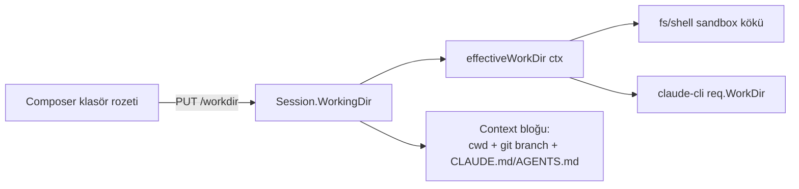

# Çalışma Dizini (Working Directory) — Oturum-Başına cwd

> **Özet (2026-09-22, güncelleme 2026-11-17):** Her sohbet oturumunun ajan araçlarının çalışacağı kendi
> çalışma dizinini (`Session.WorkingDir`) seçebilmesini sağlayan mekanik (the external agent project
> ilhamlı) — Composer'daki klasör rozeti, workspace varsayılan dizini, spawn/handoff
> seeding'i ve otonom turlar için `autonomousConfine` freni. Durum: uygulanmış ve
> olgun. En önemli/kritik karar: **confine yalnız TionHarness'in fs araçlarını kilitler,
> kabuğu KİLİTLEMEZ** — ajanın kabuğu 2026-11-17'den beri her zaman CLI'nin native
> kabuğudur (claude-cli `Bash`, codex-cli kabuğu, opencode-cli `bash`) ve
> `Sandbox.Resolve`'dan hiç geçmez; confined bir turda bile kabukla çalışma dizini
> dışına yazılabilir — bilinçli olarak "belgelenmiş, kısıtlanmamış". Confine açık otonom
> tur ("unattended") yalnız şunları alır: üç CLI'ye `GIT_CONFIG_*` ile commit/tag gpg
> imzalama kapatma env'i (`proc.DisableGitSigningEnv`) ve claude-cli'ye
> `Bash(git push:*)` / `Bash(git remote add:*)` / `Bash(git remote set-url:*)` deny
> kuralları; codex/opencode'da push freni **yoktur**. Ayrıca Windows'a özgü NT/device-namespace yol kaçışları (`\\?\`, ADS)
> ayrıca reddedilir; kök İÇİNDEKİ bir symlink/junction'ın dışarıyı göstermesi
> handle tabanlı gerçek-yol kontrolüyle reddedilir (TSK393). Eski confined kabuğun
> Windows Job Object kapsaması (TSK392) TionHarness kabuğuyla birlikte kalktı: CLI
> kabuk komutları için süreç-job kapsaması yoktur. Talimat dosyası çözümlemesi (2026-09-21) **`CLAUDE.md` önce,
> `AGENTS.md` fallback**: yalnız dosyanın ADI prompta yazılır (içerik asla inline
> edilmez — CLI'lar zaten natively yüklüyor) ve headless turlar da aynı probe'u
> alır. Dayandığı dosyalar: `internal/agent/workdir_ctx.go`,
> `internal/agent/instructionfile.go`, `internal/api/workdir_context.go`,
> `internal/tools/sandbox.go`, `internal/tools/sandbox_realpath*.go`,
> `internal/agent/toolloop_phases.go` (`unattended`, `unattendedGitDeny`),
> `internal/proc/env.go` (`DisableGitSigningEnv`).

> Eklendi: **2026-06-22**. the external agent project (external-agent-oss) "working directory"
> mekaniğinin TionHarness'e uyarlaması.

## Amaç

Her sohbet oturumunun, ajanın dosya/kabuk araçlarının çalışacağı bir **çalışma
dizini (cwd)** olabilir — tıpkı terminalde `cd /path/to/proje` yapmak gibi.
Böylece bir oturumu doğrudan bir proje klasörüne bağlayıp ajana o repoda kod
yazdırabilir, test çalıştırabilir, git kullandırabilirsin.

Bu özellik, daha önce kaldırılan **fs/shell sandbox kilidinin** (bkz.
`06-WORKSPACES.md`) doğal devamıdır: araçlar artık her yere erişebildiği için,
"nerede çalışacağını" oturum başına seçmek anlamlı hale geldi.

## Katmanlar



### 1. Veri
- `db.Session.WorkingDir` (`workingDir` JSON) — oturuma özel cwd. Boş = workspace
  varsayılanı (`Runtime.workDir`). `SetSessionWorkingDir` ile yazılır.

### 2. Çözümleme (`internal/agent/workdir_ctx.go`)
- `Runtime.effectiveWorkDir(ctx)` — ctx'teki session id'den oturumu okur;
  `WorkingDir` set ve gerçek bir dizinse onu, değilse `r.workDir`'i döndürür.
- `completeTraced` her turda çözer → `req.WorkDir` (CLI cwd) + ctx'e koyar
  (`withResolvedWorkDir`). `buildRegistry` bu ctx'ten sandbox kökünü alır.
- Chat yolları artık `agent.WithSessionID` ile session id'yi ctx'e basıyor
  (`chat_stream.go`, `chat.go`); otonom yollar (scheduler/spawn) zaten basıyordu.

### 3. Bağlam enjeksiyonu (`internal/api/workdir_context.go`)
- `workdirContextBlock(dir)` — sistem promptunun dinamik (cache-dışı) kısmına
  "Working directory" bloğu ekler: cwd yolu + git branch (`git rev-parse
  --abbrev-ref HEAD`) + bulunan talimat dosyasını okuma hatırlatması.
- `composeTurnRequest` (chat_turn.go) bu bloğu goal'dan hemen sonra ekler.

#### Talimat dosyası çözümlemesi (`internal/agent/instructionfile.go`)

`ResolveInstructionFile(dir)` sıralı aday listesini `os.Stat` ile yoklar:
**`CLAUDE.md` önce, `AGENTS.md` fallback**. İkisi de varsa CLAUDE.md kazanır ve
AGENTS.md prompt'ta hiç anılmaz; hiçbiri yoksa satır tamamen atlanır.

- **Dosya içeriği ASLA inline edilmez**, yalnız adı yazılır. claude-cli ve
  codex-cli proje dosyasını zaten natively yüklüyor; inline etmek aynı baytları
  iki kez göndermek olurdu.
- `os.Stat` hatası `fs.ErrNotExist` dışındaysa **yutulmaz**: `ResolveInstructionFile`
  hatayı döndürür. Prompt kurucularının hata kanalı olmadığı için
  `InstructionFilePromptLine` bunu ajana görünür bir satıra çevirir ("Could not
  probe…") — "bu depoda talimat dosyası yok" ile "dizin okunamadı" karıştırılmaz.
- **Büyük/küçük harf duyarlılığı dosya sisteminindir**, bu fonksiyonun değil:
  Windows'ta (ve macOS'un varsayılan APFS'inde) diskteki `claude.md` `CLAUDE.md`
  stat'ını karşılar, Linux'ta karşılamaz. Bu davranışa güvenme.
- **Headless parite:** `workdirConfineBlock` (`internal/agent/runtime_prompt.go`)
  aynı probe'u kullanır. Asıl ihtiyaç oradadır — talimat dosyasını natively
  yüklemeyen tek backend native Go araç döngüsüdür.
- Kapsam dışı (bilinçli): `@import` çözümlemesi, üst dizin yürüyüşü, kullanıcı
  home talimat dosyaları.
- Oturum bilgisi: bulunan ad `GET /api/sessions/{id}` yanıtında
  `instructionFile` (omitempty) olarak döner; panel satırı yalnız dosya
  bulunduğunda render eder.

### 4. UX (`frontend`)
- `features/chat/WorkDirBadge.tsx` — Composer'da klasör rozeti (Thinking/Permission
  rozetlerinin yanında). Klasör ikonu + dizin adı + git branch gösterir; tıklayınca
  dizin gezgini popover'ı açılır (alt klasörlere in/çık, "Bu klasörü kullan",
  "Sıfırla"). `sessionId` ile kendi kendine yeter.
- API: `GET/PUT /api/sessions/{id}/workdir`, `GET /api/fs/browse?path=`
  (`internal/api/workdir.go`). Browse boş path'te kökleri döndürür (Windows'ta
  sürücü harfleri, POSIX'te `/`).

## Otonomi frenleri (güvenlik)

Araçlar kilitsiz olduğundan, **insan döngüde olmayan** (scheduler/spawn/flow) turlar
için bir fren var (Ayarlar ▸ MCP & Araçlar):

| Ayar | Varsayılan | Etki |
|---|---|---|
| `autonomousConfine` | **açık** | Otonom turda TionHarness'in **fs araçları** çalışma dizinine **kilitlenir** (mutlak yol + `..` reddi); tur "unattended" sayılır: üç CLI'ye gpg imzalama kapatma env'i, claude-cli'ye `git push`/`git remote add`/`git remote set-url` deny kuralları. **Kabuk yolu kısıtlanmaz** (aşağıya bak). İnteraktif sohbet etkilenmez. |

- Confine, `Sandbox.Confined` bayrağını yeniden kullanır (`internal/tools/sandbox.go`):
  interaktif = `NewSandbox` (kilitsiz), otonom+confine = `NewConfinedSandbox`.
- **Unattended tur (2026-11-17):** `toolLoopTurn.unattended()` = otonom **ve**
  `autonomousConfine` açık (`internal/agent/toolloop_phases.go`). Böyle bir turda
  `ChatRequest.Unattended` set edilir; claude-cli/codex-cli/opencode-cli taşıyıcıları
  env'e `proc.DisableGitSigningEnv()` ekler (`GIT_CONFIG_COUNT=2`, `commit.gpgsign=false`,
  `tag.gpgsign=false` — headless `git commit` GPG pinentry istemine takılmasın).
  claude-cli ayrıca `unattendedGitDeny` kurallarını disallow listesine ekler:
  `Bash(git push:*)`, `Bash(git remote add:*)`, `Bash(git remote set-url:*)`.
  **Bilinen boşluk:** codex-cli ve opencode-cli'de karşılığı yok — bu CLI'lerin kabuğu
  komut deseniyle daraltılamadığından unattended turda push freni **yoktur**. Eski
  `isNetworkMutatingGit` substring freni TionHarness kabuğuyla birlikte kaldırıldı.
- **Windows yol yazımları (confined dalda, `rejectWindowsPathTricks`):** kök
  karşılaştırmasından ÖNCE açıkça reddedilenler — NT/device namespace önekleri
  (`\\?\`, `\\.\`, `\??\`, dolayısıyla `\\?\UNC\`), `GLOBALROOT` aygıt yolları ve
  NTFS alternate data stream'leri (`file.txt:stream`). Bunlar `filepath.Clean`'den
  sağ çıktığı için, kök öneki karşılaştırmasının tesadüfen tutmamasına
  güvenilmez: kural, `Sandbox.Root` bir gün uzun-yol için `\\?\` biçimine
  normalize edilse bile ayakta kalır. Sürücü harfindeki `:` meşrudur; eleman
  içindeki `:` reddedilir. Kontroller yalnız Windows'ta çalışır — başka
  platformlarda bu yazımların özel anlamı yoktur ve `:` geçerli bir dosya adı
  karakteridir. Kilitsiz (`NewSandbox`) dal tasarım gereği etkilenmez.
- Kök içi/dışı karşılaştırması (`underRoot`) Windows'ta **case-insensitive**'dir;
  bu, dosya sistemiyle ve `internal/api/files.go` içindeki `underDir` sınırıyla
  aynı davranışı verir (önceden ikisi farklıydı).
- **Kök içindeki link kaçışı (TSK393, 2026-09-22):** leksikal kontrol geçtikten
  sonra `checkRealPathUnderRoot` hem kökün hem hedefin **gerçek** yerini çözer
  (`internal/tools/sandbox_realpath*.go`). Windows'ta bu `CreateFile`
  (`FILE_FLAG_BACKUP_SEMANTICS`, erişim 0, tam paylaşım) + `GetFinalPathNameByHandle`
  ile yapılır — `filepath.EvalSymlinks` junction'ı takip etmediği için yeterli
  değildi. Var olan en derin ata handle üzerinden çözülür, henüz var olmayan
  kuyruk leksikal eklenir (var olmayan bir bileşen link olamaz). Hedefi olmayan
  (dangling) bir link "henüz yok" sayılmaz, **reddedilir**: üzerinden yazmak
  dosyayı linkin hedefinde, kökün dışında oluştururdu. Kökün kendisi junction
  ise iki taraf da handle ile çözüldüğü için kökün kendi dosyaları kabul edilir.
  Kök içinde kalan linkler serbesttir ve `Resolve` yine leksikal yolu döndürür.
  Kalan boşluk: kontrol ile aracın `open` çağrısı arasında yaratılan bir link
  (TOCTOU) görülmez; tam kapatmak her fs aracına handle-ile-aç tesisatı
  gerektirir. Testler: `sandbox_realpath_test.go` (junction ve symlink ayrı
  vakalar, dangling, kök-içi link, junction kök).

### Confine, shell'de path kısıtlamaz (2026-08-28)

`autonomousConfine` adı yanıltıcı olabilir: confine **yalnız fs araçlarını**
kapatır, kabuğu kapatmaz. (2026-11-17'den beri kabuk her zaman CLI'nin native
kabuğudur.)

| Araç | Confined turda kısıtlı mı? | Mekanizma |
|---|---|---|
| `read_file`, `write_file`, `edit_file`, `apply_patch`, `list_dir`, `glob`, `grep`, `config_validate` | **Evet** | Her yol argümanı `Sandbox.Resolve`'dan geçer; mutlak yol ve `..` kaçışı reddedilir. |
| CLI'nin native kabuğu (claude-cli `Bash`, codex-cli kabuğu, opencode-cli `bash`) | **Hayır** | TionHarness'ten hiç geçmez; `Sandbox.Resolve` çağrılmaz. Yalnız başlangıç cwd'si çalışma dizinidir. |
| `transform_data` | **Argümanlar evet, script gövdesi hayır** | Koşulsuz kayıtlı (eski `ShellEnabled` kapısı 2026-11-17'de kalktı), ana makinede python/node çalıştırır. |

`transform_data` input/output argüman yollarını `Sandbox.Resolve` üzerinden
kısıtlar. Ancak script gövdesi rastgele ana makine kodu çalıştırdığı için kendi
dosya erişimini açabilir ve bu argüman kısıtını aşabilir.

Eskiden (TionHarness'in kendi kabuğu varken) confined bayrağı kabuk yolunda üç şey
yapıyordu: gpg imzalama kapatma env'i, `isNetworkMutatingGit` ile `git push` /
`git remote add` / `git remote set-url` engeli ve ön plan komutunu bir süreç işine
(job) alma. 2026-11-17'den beri yalnız ilk ikisinin karşılığı var (yukarıdaki
"Unattended tur" maddesi: env üç CLI'de, push freni yalnız claude-cli'de); süreç-job
kapsaması yoktur.

Gerçek tek sınır **süreç çalışma dizinidir**. Yani confined bir turda TionHarness'in
fs aracıyla `/c/başka/yer` yazılamaz ama CLI kabuğunda
`sh -c 'echo x > /c/başka/yer/f'` serbesttir — kabuk, fs araçlarının kısıtını
komple bypass eder.

**Neden statik komut ayrıştırma çözüm değil:** komut metninden yol çıkarıp
reddetmek güvenilir biçimde yapılamaz. `cat $(echo /c/x)`, `p=/c/x; cat "$p"`,
`cd /c/x && cat f`, `python -c "open('/c/x')"` — hepsi her ayrıştırıcıyı deler.
Yarım koruma "kısıtlı" etiketiyle sunulduğunda, hiç koruma olmamasından daha
kötüdür: yanlış güven yaratır. Bu yüzden mevcut davranış **belgelenmiştir,
kısıtlanmamıştır**.

Gerçek **yol** sınırı için kimlik düzeyinde OS izolasyonu gerekir (aşağıdaki
seçenekler); o iş TSK392'den ayrılan yeni bir pbi kartındadır.

### Süreç sınırı: confined shell Job Object içinde (TSK392, 2026-09-22) — KALDIRILDI (2026-11-17)

TionHarness'in kendi kabuğu varken confined ön plan komutu `proc.Job`
(`internal/proc/job_windows.go`; Windows dışında süreç grubu / cgroup) içinde koşuyordu:
`KILL_ON_JOB_CLOSE` ile kopmuş alt süreçler dahil tüm ağaç çağrı bitince ölüyor,
`ACTIVE_PROCESS` = 128 fork bombasını frenliyordu. Kabuk kaldırılınca bu kapsama da
kalktı: CLI'nin native kabuğunda koşan komutlar CLI taşıyıcısının alt süreçleridir ve
TionHarness onları bir job'a almaz (`internal/proc/job*.go` yerinde ama kabuk için
çağıranı yok). Otonom bir CLI turu, araç çağrısı bittikten sonra da çalışan kopmuş
süreç bırakabilir — **bilinen boşluk**. Job zaten bir yol sınırı değildi.

**Yol sınırı için seçenekler (analiz, uygulanmadı):**

| Seçenek | Ne verir | Maliyet / risk |
|---|---|---|
| Job Object (2026-09-22 uygulandı, 2026-11-17 kabukla birlikte kaldırıldı) | Süreç ağacı + kaynak sınırı | Yol sınırı yok |
| Düşük yetkili ayrı kullanıcı + kökte ACL | Gerçek dosya sistemi sınırı | Hesap yönetimi, `CreateProcessWithLogonW` kimlik bilgisi, git/araç zinciri profili, kök dışındaki araç yollarına (Go, node, git) okuma izni |
| AppContainer / LPAC | Kullanıcı eklemeden dosya sistemi + ağ sınırı | Git-bash/MSYS ve çoğu CLI AppContainer'da kırılır; erişilecek her dizine capability SID ACL'i gerekir |
| Container (Docker / WSL) | Tam izolasyon | Windows araç zinciri kaybı, başlatma gecikmesi, dosya senkronu |

> **Not (2026-08-26):** Eski per-session `gitWorktreeIsolation` özelliği kaldırılmış
> kalır. Yerine kart yaşam döngüsünün tek sahibi olan `internal/worktree` geldi:
> `todo` worktree açar, `done` base dala merge eder, `iptal`/`failed` güvenli temizlik
> yapar. Dirty veya base'e ulaşmamış commit varsa silmez; merge çatışmasında worktree'yi
> korur. Base ref ve worktree kökü workspace ayarlarıdır. Aşağıdaki **geliştirici**
> worktree scripti bundan ayrıdır ve durmaktadır.
> `worktreeBaseRef` boşsa açık workspace'in gerçek HEAD dalı kullanılır; detached veya
> unborn HEAD açık hatadır, `main`/`master` tahmini yapılmaz. Ayar workspace açılırken
> yaşam döngüsüne snapshot edildiğinden değişiklik mevcut workspace yeniden açıldıktan
> sonra yeni kart worktree'lerine uygulanır.

### Geliştirici worktree'leri (`scripts\worktree.ps1`) — ajan izolasyonundan AYRI

**İnsan geliştirici** için aynı anda birden çok dalda çalışmayı
(stash/checkout gidip-gelmesi olmadan) kolaylaştıran bir yardımcı script vardır:

```powershell
.\scripts\worktree.ps1 add    feat-login                        # yeni dal: feature/feat-login
.\scripts\worktree.ps1 add    hotfix -Branch fix/crash -Existing # mevcut dalı bağla
.\scripts\worktree.ps1 list
.\scripts\worktree.ps1 remove feat-login
.\scripts\worktree.ps1 prune
```

Worktree'ler reponun **kardeşi** olarak açılır (ör. `...\Projects\TionHarness-feat-login`);
tek `.git` deposu paylaşılır, her worktree'nin kendi çalışma dizini + dalı olur.
`add` sırasında `frontend/node_modules` ana repodan **junction** ile bağlanır (sıfırdan
`npm install` beklemezsin); `-NoLink` verirsen bunun yerine `npm install` koşar.

## Akış matrisi

| Tur tipi | fs araçları | CLI kabuğu path | git push |
|---|---|---|---|
| İnteraktif sohbet | Kilitsiz | Kilitsiz | Serbest |
| Otonom + confine açık (unattended) | Çalışma dizinine kilitli | **Kilitsiz** (yalnız cwd = çalışma dizini) | claude-cli: deny kuralıyla engelli · codex/opencode: **serbest** (fren yok) |
| Otonom + confine kapalı | Kilitsiz | Kilitsiz | Serbest |

## the external agent project ile fark

- **Eşit:** oturum-başına cwd, klasör rozeti, cwd değiştirme, git branch göstergesi,
  talimat dosyası (CLAUDE.md/AGENTS.md) farkındalığı, makine geneli erişim.
- **TionHarness'e özgü:** otonom turlar (scheduler/flow/spawn) için confine freni —
  the external agent project interaktif olduğu için buna ihtiyaç duymaz.

## Workspace varsayılan çalışma dizini (2026-06-22)

the external agent project paritesi: workspace başına "varsayılan çalışma dizini".
- `WSSettings.DefaultWorkingDir` (`ws-settings.json`) — Ayarlar ▸ Bu Workspace ▸
  "Varsayılan çalışma dizini" alanından girilir (mutlak yol).
- Runtime'a `SetDefaultWorkDir` ile uygulanır; `Runtime.WorkspaceDefaultDir()`
  geçerli ve var olan bir dizinse onu, değilse fiziksel `workDir`'i döndürür.
- `effectiveWorkDir` çözüm sırası: **oturum `WorkingDir`** → **workspace
  `DefaultWorkingDir`** → fiziksel `workDir`.
- **Yeni oturuma seeding (2026-06-26):** `handleCreateSession` artık yeni oturumun
  `WorkingDir`'ini workspace'in `DefaultWorkingDir`'i ile **tohumlar** (istek kendi
  `workingDir`'ini vermezse). Böylece her yeni oturum o path'e **kilitli başlar** ve
  Composer rozeti yolu `Dir` olarak (yalnız `effective` fallback değil) gösterir.
  Path boşsa eskisi gibi fiziksel `workDir`'e düşer. Not: bu bir kopyadır —
  varsayılanı sonradan değiştirmek, zaten tohumlanmış eski oturumların `WorkingDir`'ini
  geriye dönük değiştirmez (runtime fallback yalnız `WorkingDir` boş kalan oturumlarda
  varsayılanı izlemeye devam eder).
- **Spawn/handoff seeding (2026-06-26):** `SpawnOptions.WorkingDir` eklendi;
  `Runtime.SpawnSession` yeni oturumun `WorkingDir`'ini açık seçenek varsa onunla,
  yoksa workspace'in yapılandırılmış default'u (`defaultWorkDir`) ile tohumlar →
  spawn edilen (ve `spawn_session` aracı/UI ile açılan) oturumlar da Path'e kilitli
  başlar. **Handoff** continuation'ı ayrıca ebeveyn oturumun `WorkingDir`'ini geçirir
  → context-reset sonrası taze oturum **aynı dizinde** devam eder. Default boşsa alan
  boş kalır (runtime fiziksel `workDir`'e düşer).

## Workspace penceresi + Proje sekmesi (2026-06-22)

Workspace + path ayarları artık Ayarlar'dan ayrı, **sol navbar'daki "Workspace"
butonuyla** açılan kendi penceresinde (`features/workspace/WorkspaceView.tsx`).
Sol alt-navbar (Settings/Logs benzeri) üç sekme:
- **Genel** — kimlik, sağlayıcı/model, otonomi, session bağlamı (`WorkspacePanel`).
- **Proje** (`ProjectPanel`) — proje dizini (path) seçici + **git**: depo durumu,
  `git init` (yoksa), klasör hiç yoksa **"Klasörü oluştur + git init"** (istek alanı
  `createDir`; yalnız bu daldan gönderilir ki yazım hatası boş klasör açmasın),
  origin remote URL + `user.name`/`user.email` ayarları.
- **Promptlar** — düzenlenebilir config dosyaları (`WorkspaceFilesPanel`).

Git endpoint'leri (`internal/api/git.go`): `GET /api/fs/gitinfo?path=`,
`POST /api/git/init`, `POST /api/git/config` (origin remote + commit kimliği).
TionHarness'in kendi başlattığı her depoya (`prepareGitRepo`) gömülü bir **başlangıç
`.gitignore`** yazılır (`internal/api/defaults/gitignore.txt`): sırlar (`.env`),
bağımlılıklar (`node_modules/`, `.venv/`), build çıktısı, loglar, editör/OS artıkları
ve `.tionharness/`. **Var olan `.gitignore` asla ezilmez**; zaten repo olan klasöre
hiç dokunulmaz. Dosya kullanıcının deposunda düz metindir, serbestçe düzenlenebilir.

Yanıttaki `gitInstalled` alanı makinede git binary'si olup olmadığını söyler
(`exec.LookPath`); yoksa UI `git init` butonu yerine "git kurulu değil" der ve
endpoint 400 döner. Aynı kontrol workspace oluşturma modalındaki "Git deposu
başlat" onay kutusunu da yönetir (bkz. `_Docs/06-WORKSPACES.md`).
Secrets de NavRail'den çıkıp **Ayarlar ▸ Sırlar** alt-kategorisine taşındı; UI'da
"Beceri/Beceriler" terimleri **Skill/Skills**'e çevrildi.
